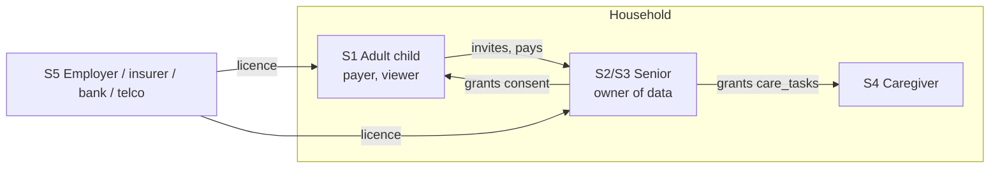
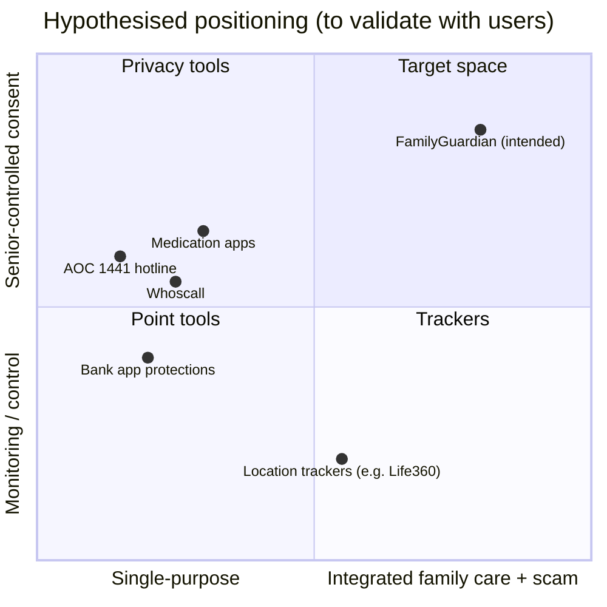
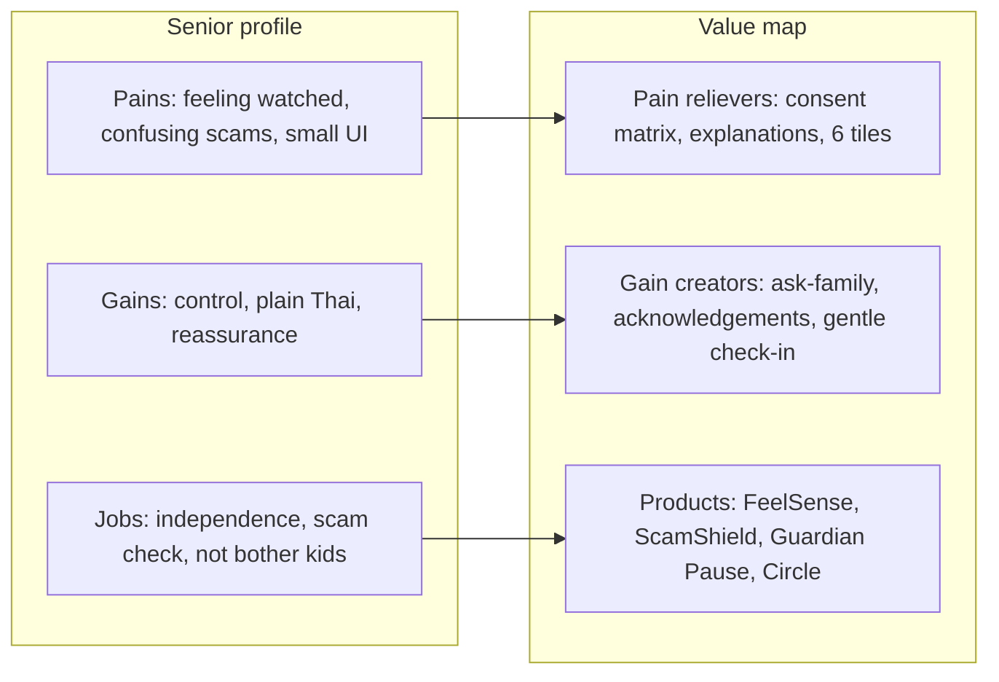

DRAFT — requires Product Owner review; numbers are assumptions unless cited.

# 01 — Segmentation, Targeting, Positioning and Value Proposition

| Field | Value |
|---|---|
| Project | FamilyGuardian AI (FGAI-2026-001) |
| Owner | Payment & Business Agent (business strategy) |
| Date | 2026-11-05 |
| Status | DRAFT v0.1 |
| Sources read | `docs/product/01_DISCOVERY_AND_SCOPE.md`, `docs/architecture/03_ARCHITECTURE.md` §6, `docs/decisions/DECISIONS_LOG.md` |

**Labels:** **[Evidence]** = backed by a cited public source (URL, accessed 2026-11-05). **[Hypothesis]** = a belief to test with users. **[Estimate]** = a number we made up for planning. Nothing from user interviews has been collected yet, so **every customer job, pain and gain below is a [Hypothesis] until discovery interviews are done.**

---

## 1. Market context (why now)

| # | Claim | Label | Source |
|---|---|---|---|
| M1 | About 20% of Thais were aged 60+ in 2024 (NSO figure as reported). A 2023 survey counted 13.64 million people aged 60+ (19.5%). | [Evidence] | https://nationthailand.com/thailand/policies/40037391 |
| M2 | The Mahidol IPSR 2025 gazette lists 14,459 thousand people aged 60+ out of 65,697 thousand (about 22% by our own division). | [Evidence] (our arithmetic) | https://ipsr.mahidol.ac.th/wp-content/uploads/2025/01/Gazette2025EN.pdf |
| M3 | Roughly 58% of Thais aged 60+ used the internet in Q3 2023 (Statista, based on NSO data). We could not open the NSO table ourselves. | [Evidence], secondary | https://statista.com/statistics/1472650/thailand-share-of-elderly-people-who-use-the-internet |
| M4 | The Royal Thai Police CCIB reported about 14,000 senior-related online fraud cases in 2024, with losses of about 4.4 billion THB. The article does not define the age threshold. | [Evidence], news report of police data | https://en.vietnamplus.vn/thai-police-step-up-efforts-to-protect-senior-citizens-from-cyber-scams-post310138.vnp |
| M5 | Scammers posing as bank or government staff target older Thais. | [Evidence], news | https://thethaiger.com/news/national/elderly-thais-targeted-by-scammers-posing-as-bank-agents |
| M6 | Many adult children live and work away from their parents, so they cannot check in face to face every day. | [Hypothesis]: plausible, but we have no Thai migration or co-residence source yet | To source: NSO Survey of Older Persons |

---

## 2. Segmentation

We segment by **who pays and who uses**. FamilyGuardian is a "two-sided household" product: the senior uses it and an adult child often pays.

| Segment | Description | Size signal | Attractiveness | Label |
|---|---|---|---|---|
| **S1 Distant adult children (payer)** | Aged 30–55, urban (Bangkok/EEC) or overseas, with parents 65+ living upcountry or alone. Use smartphones heavily and are comfortable with digital payment. | Unknown. To estimate from NSO co-residence data | **High**: pain is felt strongly and they have the ability to pay | [Hypothesis] |
| **S2 Independent digitally-capable seniors (user, sometimes payer)** | Aged 60–80 with a smartphone and LINE. Want independence, worried about scams, may have a pension or savings. | Subset of M1 × M3 | **High as users**. Willingness to pay is uncertain | [Hypothesis] |
| **S3 Low-digital seniors** | Feature phone, or a smartphone used only for calls and LINE. Need a family member to set it up. | Large (about 40% offline per M3) | Medium. Reachable only through a family or B2B2C channel | [Hypothesis] |
| **S4 Family caregivers / paid carers** | Part-time carers or relatives handling medication and appointments. | Unknown | Medium. A feature user, rarely the payer | [Hypothesis] |
| **S5 B2B2C organisations** | Employers (as an employee benefit), insurers (life/health), banks (fraud-prevention CSR or product), telcos (value-added service bundles), hospitals (post-discharge). | Count of large Thai employers and insurers is knowable | **High value, long sales cycle** | [Hypothesis] |

---

## 3. Targeting

| Priority | Target | Why | What would change our mind |
|---|---|---|---|
| **Primary (beachhead)** | **S1 + S2 pairs**: an adult child in Bangkok with a parent aged 65–80 who already uses LINE on a smartphone | Shortest path to a paid conversion. The child feels the anxiety and pays, and the senior can use the PWA without hardware. | Fewer than 30% of interviewed S1 say they would pay anything (see `03_revenue_payment_strategy.md` §3) |
| Secondary | **S5 employers** with HR "family care" benefits and **insurers** | One contract reaches many families and lowers CAC | No pilot interest from 10 outreach attempts |
| Later | S3 through telco or bank bundles, and S4 caregivers | Needs partner distribution and a native app | — |

---

## 4. Positioning

**Positioning statement [Hypothesis]:**
> For **adult children who live away from their ageing parents**, and for **parents who want to stay independent**, **FamilyGuardian** is a **consent-first family safety companion** that combines a gentle daily check-in, a scam-message checker and a pause before money transfers. **Unlike** location trackers, caller-ID apps or bank tools that each cover one slice, FamilyGuardian lets the **senior decide what is shared**, explains risk in plain Thai, and connects the family and trusted human help, **without surveillance**.

Brand promise: **"Care Beyond Distance. Protect Without Controlling."**

### 4.1 Perceptual map (hypothesised; not measured)

The coordinates are our judgement only [Hypothesis]. See `05_competitor_landscape.md` for each competitor's features and sources.

### 4.2 Points of difference vs points of parity

| Type | Item | Label |
|---|---|---|
| Point of difference | The senior owns consent per category × member × expiry, with one-tap revoke (built into the product; see S-09 and F-03 in the scope doc) | Product fact (design) |
| Point of difference | Scam checker that **never says "safe"** and shows its evidence and uncertainty | Product fact (design) |
| Point of difference | Guardian Pause: a 4-question reflection before a transfer, with no bank connection | Product fact (design) |
| Point of difference | Honest status labels ("call started from app", never "connected"; no claims that an agency was notified) | Product fact (design) |
| Point of parity | Reminders, contact lists and emergency numbers | Common in the market |
| Unknown | Whether consent-first is a **purchase driver** or just a hygiene factor | [Hypothesis]: test in interviews |

---

## 5. Value Proposition Canvas — (a) Adult children (S1)

### Customer profile [Hypothesis — every item to be validated]

| Customer jobs | Pains | Gains |
|---|---|---|
| J1 Know that my parent is okay today without calling three times | P1 Anxiety when the parent doesn't answer the phone | G1 Peace of mind in under 10 seconds a day |
| J2 Protect my parent from scams without taking over their bank account | P2 Fear of a parent losing their savings to a "bank officer" or "police" call (see M4, M5) | G2 Being asked **before** a transfer, not after the loss |
| J3 Coordinate siblings and carers | P3 Feeling guilty about not being there; sibling conflict over "who checks" | G3 Shared, fair visibility across siblings |
| J4 Respect my parent's dignity and independence | P4 The parent refuses "spy apps"; arguments about control | G4 The parent feels respected and keeps using it |
| J5 Act quickly when help is needed | P5 Not knowing which official number to call, or whether help is on its way | G5 A clear next step and honest status |

### Value map

| Products & services | Pain relievers | Gain creators |
|---|---|---|
| Family dashboard (consented categories only) | Neutral "no check-in today" instead of an alarm (P1) | One status label per parent: "No Action Needed" / "Check In Recommended" / … (G1) |
| ScamShield shared results | The parent can send a suspicious message to me in one tap (P2) | "This is not me / not our bank" reply (G2) |
| Guardian Pause alerts (if the senior grants it) | A pause appears at the moment of risk (P2) | Fewer large losses [Hypothesis, needs measurement] (G2) |
| Multi-member Family Circle with per-member grants | Each sibling sees what the parent chose (P3) | Acknowledgement trail ("Nok acknowledged 09:12") (G3) |
| Consent matrix that the senior controls | Removes the "spying" objection (P4) | The parent stays an active user (G4) |
| Help request with real delivery states + verified help directory | No false reassurance (P5) | Escalation to the next contact if no one acknowledges (G5) |

## 6. Value Proposition Canvas — (b) Seniors (S2)

### Customer profile [Hypothesis — every item to be validated]

| Customer jobs | Pains | Gains |
|---|---|---|
| J1 Stay independent at home | P1 Feeling watched or treated as a child | G1 "I decide what my children see" |
| J2 Tell whether a message, call or link is a scam | P2 Confusing Thai bank and government impersonation messages; embarrassment at being fooled | G2 A plain-Thai explanation I can understand and show my family |
| J3 Avoid bothering my busy children | P3 Not wanting to "disturb" them by calling | G3 A gentle daily check-in that lets them know I'm fine |
| J4 Remember medicines and appointments (P1 feature) | P4 Small print, too many apps, complicated menus | G4 Six big tiles, large text, Thai first |
| J5 Get help fast if something goes wrong | P5 Not knowing who to call; fear that nobody will answer | G5 One tap to a trusted person; see who acknowledged |

### Value map

| Products & services | Pain relievers | Gain creators |
|---|---|---|
| Senior home with 6 large tiles (Thai first) | Low cognitive load (P4) | Usable without help in under a minute [target, to test] (G4) |
| FeelSense check-in (6 options incl. "prefer not to say", optional sharing) | "Only me" option; no diagnosis (P1) | Children are reassured without phone calls (G3) |
| ScamShield (rules engine, never "safe") | Explains **why** with evidence (P2) | "Ask family" and "call 1441" buttons (G2) |
| Guardian Pause | Time to think under pressure (P2) | A face-saving reason to say "I need to check with my daughter" (G2) |
| Trusted contacts + Request Help | One tap; honest status (P5) | Visible acknowledgement by name (G5) |
| Privacy matrix + "who viewed my info" | Transparency (P1) | Control and dignity (G1) |

---

## 7. Fit tests (to run before the pricing decision)

| Test | Method | Pass threshold (proposed) | Label |
|---|---|---|---|
| Problem–solution fit (S1) | 15–20 semi-structured interviews with adult children | ≥ 60% rank scams or "not knowing they're OK" among their top 2 worries | [Hypothesis] threshold |
| Problem–solution fit (S2) | 10–15 interviews and usability sessions with seniors aged 60–80, consent and ethics forms first (B5) | ≥ 70% finish a check-in unaided; ≥ 60% say they would keep using it | [Hypothesis] threshold |
| Consent-first value | Card-sort or conjoint: "senior controls sharing" vs "family sees everything" | Senior preference ≥ 70% for control; adult children's acceptance ≥ 50% | [Hypothesis] |

Ethics note: interviews with older adults need informed consent, and a PDPA review is needed before any real data is collected (see blocker B5 in the scope doc).
