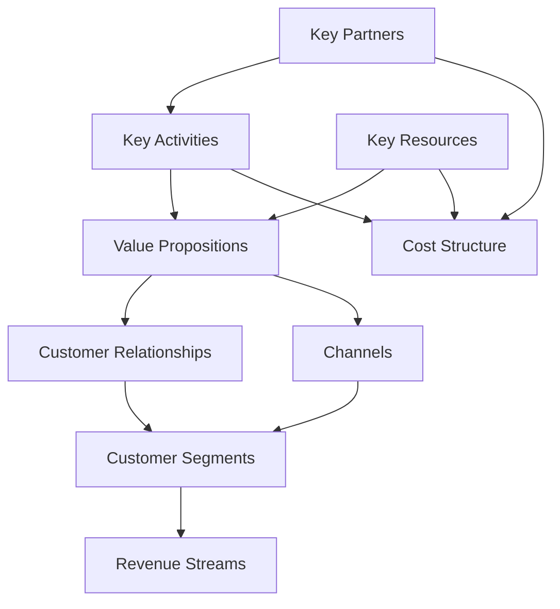

DRAFT — requires Product Owner review; numbers are assumptions unless cited.

# 02 — Business Model Canvas

| Field | Value |
|---|---|
| Project | FamilyGuardian AI (FGAI-2026-001) |
| Date | 2026-11-05 |
| Status | DRAFT v0.1 |
| Related | `01_stp_value_proposition.md`, `03_revenue_payment_strategy.md`, `04_unit_economics.md` |

Labels: **[Evidence]** (URL), **[Hypothesis]**, **[Estimate]**. Unless marked otherwise, every block is a **[Hypothesis]** for the ENT501 stage.

---

## Canvas at a glance

| Key Partners | Key Activities | Value Propositions | Customer Relationships | Customer Segments |
|---|---|---|---|---|
| Payment gateway (authorised); bank and telco partners (P2); verified help directory owners (AOC 1441, 1669, 191); NGOs and elderly clubs; employers and insurers; PDPA/legal advisor | Product development; maintaining the ScamShield rules; verifying the help directory; consent and privacy operations; trusted-human-help operations; B2B sales | "Care Beyond Distance. Protect Without Controlling.": a consent-first daily check-in, scam checker, Guardian Pause, family circle and honest help escalation | Self-serve onboarding with family-assisted setup; in-app education; human help line (Guardian Plus); B2B account management | Adult children (payer); independent seniors (user); caregivers; B2B2C organisations |
| | **Key Resources** | | **Channels** | |
| | Rules engine and scam-pattern library; consent/policy engine; Thai UX for seniors; brand trust; verified directory data; team | | Web PWA (P0); LINE OA and community; elderly clubs and temples; HR benefit portals; insurer, bank and telco bundles; social video (TikTok, YouTube) for awareness | |
| **Cost Structure** | | | **Revenue Streams** | |
| Engineering and design; cloud hosting (Thai/SEA region); notification costs (push, email, later SMS); human-help staff; payment fees (to verify with provider); compliance (PDPA, security review); CAC (content, ads, partnerships) | | | Freemium subscriptions: Free ฿0, Family Care ฿199/month, Guardian Plus ฿349/month [Hypothesis]; B2B2C licences (per seat or per contract) [Hypothesis]; **no** sale of personal data and **no** ads that use health or scam data | |

---

## 1. Customer Segments
| Segment | Role | Label |
|---|---|---|
| Distant adult children aged 30–55 | Primary payer; family dashboard viewer | [Hypothesis] |
| Independent seniors aged 60–80 with a smartphone | Primary user and **data owner** | [Hypothesis] |
| Caregivers (family or paid) | Care-task user (P1) | [Hypothesis] |
| B2B2C: employers, insurers, banks, telcos, hospitals | Licence buyer | [Hypothesis] |

Context: about 20% of Thais are aged 60+ ([Evidence] https://nationthailand.com/thailand/policies/40037391).

## 2. Value Propositions
- **Seniors:** control over what is shared; plain-Thai scam explanations that never claim "safe"; a pause before transfers; one-tap help with honest status. [Hypothesis on value; the features themselves are designed in scope]
- **Adult children:** daily reassurance without surveillance; an early "verify possible scam" signal; coordination across siblings. [Hypothesis]
- **B2B2C:** a measurable family-wellbeing and fraud-awareness benefit; aggregate-only reporting (k ≥ 10 cohort minimum, see OA-01). [Hypothesis]
- **Not offered:** location tracking, call recording, reading SMS or LINE, diagnosis, or claims that an agency was notified (scope §3.2).

## 3. Channels
| Phase | Channel | Purpose | Label |
|---|---|---|---|
| Awareness | Social video (TikTok, YouTube, Facebook), LINE OA, scam-awareness content | Reach adult children | [Hypothesis] |
| Awareness | Elderly clubs, community centres, police "Senior's Club"-type programmes | Reach seniors with trust | [Hypothesis]; a police senior programme exists: https://tna.mcot.net/english-news-1489964 [Evidence] |
| Purchase | Web checkout (PWA) through an authorised gateway | Subscription | [Hypothesis]; see `03` |
| Purchase (P2) | Native app with Apple/Google in-app purchase | Subscription in apps | Platform rules apply; see `03` |
| B2B | Direct sales, HR benefit platforms, insurer and telco bundles | Licences | [Hypothesis] |
| Marketplaces | Shopee/Lazada/TikTok Shop | **Acquisition only**, subject to each platform's rules on digital goods; not a guaranteed sales outlet | See `03` §5 |

## 4. Customer Relationships
- Self-serve onboarding with a **family-assisted setup** (the adult child invites; the senior confirms with a code).
- In-app education ("scam of the week") [Hypothesis].
- Guardian Plus: access to trusted human help (staffed hours to be defined) [Hypothesis].
- B2B: named account manager and quarterly aggregate reports [Hypothesis].
- Trust mechanics: transparency log, easy export and delete, no dark patterns in cancellation.

## 5. Revenue Streams
| Stream | Price hypothesis | Notes |
|---|---|---|
| Free | ฿0 | Check-in, basic ScamShield, 1 family member, emergency directory [Hypothesis on tier contents] |
| Family Care | ฿199/month | Up to N family members, full ScamShield, Guardian Pause sharing, reminders [Hypothesis] |
| Guardian Plus | ฿349/month | Family Care + trusted human help + priority follow-up [Hypothesis] |
| B2B2C licence | Custom | Per enrolled family per month, or per contract [Hypothesis] |
| Excluded | — | Selling or renting data; ads using sensitive data |

Details and test plan: `03_revenue_payment_strategy.md`.

## 6. Key Resources
- Deterministic ScamShield rules and test corpus (`packages/ai`).
- Consent/policy engine (`policy.ts`, ADR-005).
- Thai senior-friendly UX and copy (needs native-speaker and older-adult review, A9).
- A **verified** help directory (each entry with source URL, verifier and date; AD-02).
- Brand trust: privacy-first reputation [Hypothesis on value].

## 7. Key Activities
- Build and harden the MVP (INC-0 to INC-5).
- Keep ScamShield rules up to date with current Thai scam patterns.
- Verify and re-verify official help numbers (B4).
- Run privacy and PDPA operations (B5): consent records, DSAR handling, retention purges.
- Operate the human-help service (Guardian Plus).
- B2B pilots and sales.

## 8. Key Partners
| Partner | What they provide | Status |
|---|---|---|
| Authorised payment gateway (e.g. Opn/Omise, 2C2P, GB Prime Pay) | Hosted checkout, PromptPay, cards, wallets | No contract. Sandbox only (A7) |
| Apple / Google (P2) | App distribution and in-app purchase | Not started |
| AOC 1441, 1669, 191 | Official help routes the app **links to** (no integration) | Numbers need human verification (B4) |
| Banks / telcos | Distribution and bundles; future fraud-signal integration (P2) | [Hypothesis] |
| Employers / insurers | B2B2C licences | [Hypothesis] |
| Elderly associations, NGOs, universities | Research access, trust, pilot recruitment | [Hypothesis] |
| PDPA / legal advisor, DPO | Compliance review | Required before the pilot (B5) |

## 9. Cost Structure
| Cost | Type | Driver | Label |
|---|---|---|---|
| Product and engineering team | Fixed | Headcount | [Estimate]; see `04` |
| Cloud hosting and database | Semi-variable | Active users | [Estimate] |
| Notifications (push, email; SMS later) | Variable | Alerts per family | [Estimate] |
| Payment processing | Variable | % of revenue; **to verify with provider** | Published rates exist but must be confirmed (see `03`) |
| App-store commission (P2, native apps only) | Variable | % of in-app revenue; **to verify with Apple/Google** | — |
| Human help staff | Semi-variable | Guardian Plus subscribers × contact rate | [Estimate] |
| Compliance and security | Fixed | Audits, legal | [Estimate] |
| Customer acquisition | Variable | CAC | [Estimate] |

Cost-driven or value-driven? **Value-driven**, with lean, cost-controlled operations, because trust and safety are the product [Hypothesis].
