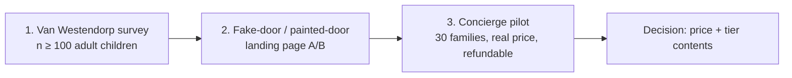

DRAFT — requires Product Owner review; numbers are assumptions unless cited.

# 03 — Revenue and Payment Strategy

| Field | Value |
|---|---|
| Project | FamilyGuardian AI (FGAI-2026-001) |
| Date | 2026-11-05 |
| Status | DRAFT v0.1. Pricing is a **hypothesis** (assumption A10). Payments are **sandbox only** (A7, ADR-008, architecture §6) |

Labels: **[Evidence]** (URL, accessed 2026-11-05), **[Hypothesis]**, **[Estimate]**.

---

## 1. Revenue streams

| # | Stream | Who pays | Model | Label |
|---|---|---|---|---|
| R1 | **Family Care** subscription | Adult child (or senior) | Monthly or annual recurring; one subscription covers one family (senior + members) | [Hypothesis] |
| R2 | **Guardian Plus** subscription | Adult child | Monthly or annual; adds trusted human help and priority follow-up | [Hypothesis] |
| R3 | **B2B2C licence** | Employer, insurer, bank, telco, hospital | Per enrolled family per month (PEFPM) or an annual contract with a seat cap | [Hypothesis] |
| R4 | Pilot / sponsored programmes | CSR budgets, foundations, local government | Fixed-fee pilot | [Hypothesis] |
| — | **Excluded by policy** | — | No selling or renting personal data, no targeted ads using health or scam data, no commissions from financial products pushed to seniors | Product principle |

### 1.1 Tier hypotheses

| Feature | Free ฿0 | Family Care ฿199/mo | Guardian Plus ฿349/mo |
|---|---|---|---|
| FeelSense daily check-in + personal trend | ✓ | ✓ | ✓ |
| ScamShield (text, URL, phone string) | ✓ (daily cap TBD) | ✓ unlimited | ✓ unlimited |
| Emergency directory (verified entries) | ✓ | ✓ | ✓ |
| Family Circle members | Up to 2 | Up to 5 [Hypothesis] | Up to 10 [Hypothesis] |
| Guardian Pause + sharing with a trusted person | ✓ (owner decision 2026-11-05: free on every plan) | ✓ | ✓ |
| Help request with follow-up / escalation | Basic | ✓ | ✓ + priority |
| Medication / appointment reminders, care tasks (P1) | — | ✓ | ✓ |
| Trusted human help (staffed hours TBD) | — | — | ✓ |
| Annual plan | — | ฿1,990/yr? [Hypothesis, ~17% off] | ฿3,490/yr? [Hypothesis] |

**Safety principle:** safety-critical basics (emergency numbers, the ability to request help, a basic scam check, Guardian Pause) stay **free**. We do not put core safety behind a paywall [Hypothesis on business impact; product principle].

Price anchors from the market (for context, not proof of willingness to pay):
- Whoscall Premium in Thailand was reported at **59 THB/month or 599 THB/year** ([Evidence], may be outdated: https://www.bangkokpost.com/life/tech/2323406/gogolook-chooses-thailand-to-be-its-new-regional-hub). Whoscall now offers Individual, Duo and Family (up to 5) plans; the Thai prices were not visible in text ([Evidence]: https://www.whoscall.com/en/blog/articles/2088-Introducing%20Whoscall%20Premium%20Duo%20&%20Family-%20Share%20Your%20Shield,%20Protect%20Your%20Circle).
- A Medisafe 1-year premium subscription was reported at ฿1,490 on the Thai App Store (a search snippet; **not verified** by opening the page: https://apps.apple.com/th/app/id573916946).
- **Implication [Hypothesis]:** ฿199/month is about 3.4× the reported Whoscall monthly price. FamilyGuardian must prove **family-level** value (several members, human help), not just "scam blocking".

---

## 2. Pricing test plan

We test willingness to pay (WTP) in sequence, from cheapest to most realistic.



### 2.1 Van Westendorp Price Sensitivity Meter (survey)
- **Who:** at least 100 adult children (S1) recruited from LINE groups, social ads and university networks. Report results by segment (Bangkok vs upcountry parent; income band).
- **The four questions (in Thai)**, asked after a 60-second concept video. At what monthly price for the whole family would FamilyGuardian be… (1) so cheap you'd doubt its quality? (2) a bargain? (3) getting expensive but still worth considering? (4) too expensive to consider?
- **Output:** the acceptable price range (from the point of marginal cheapness to the point of marginal expensiveness) and the optimal price point. **Decision rule [Hypothesis]:** keep ฿199 if it falls inside the acceptable range for the primary segment; otherwise adjust.
- Add a **Gabor-Granger** follow-up ("Would you buy at ฿149 / ฿199 / ฿249?") to estimate the demand curve.
- Limitation: stated preference overstates real WTP.

### 2.2 Fake-door (painted-door) test
- A landing page with 3 price variants (e.g. ฿149 / ฿199 / ฿249 for Family Care) and an "upgrade" button. Clicking it shows **"Coming soon — join the waitlist"**. **No payment is collected**, and the page states clearly that the product is in development.
- **Metric:** click-through to "upgrade" per unique visitor, and waitlist sign-up rate, per price variant.
- **Ethics:** honest disclosure after the click; no dark patterns; a PDPA notice for any email or LINE ID collected.

### 2.3 Pilot WTP (concierge, 30 families — proposal, B3)
- Offer the real price with a 30-day free trial and a full refund guarantee. Measure trial→paid conversion, month-2 retention and refund requests.
- The pilot only starts once the PDPA / ethics review (B5) and a live payment gateway contract are approved. Until then the pilot uses **sandbox billing** and an "intent to pay" commitment instead of real charges.

| Test | Primary metric | Proposed pass threshold | Label |
|---|---|---|---|
| Van Westendorp | ฿199 inside the acceptable range | Yes for the primary segment | [Hypothesis] |
| Fake door | "Upgrade" CTR at ฿199 | ≥ 5% of visitors who view pricing | [Estimate] threshold |
| Pilot | Trial→paid | ≥ 25% of trial families | [Estimate] threshold |
| Pilot | Month-2 retention of payers | ≥ 80% | [Estimate] threshold |

---

## 3. Payment channels (Thailand)

All payments go through an **authorised payment gateway** using **hosted checkout**. No card data touches our servers (architecture §6). The MVP uses the **SandboxProvider only**. Live providers stay disabled until `PAYMENTS_LIVE=true` **and** credentials exist **and** a release flag is signed.

| Channel | Use case | Recurring support | Published fee | Label |
|---|---|---|---|---|
| **PromptPay QR** | Most familiar for Thais; one-off and annual payments | Recurring support per gateway **to verify with provider**. Likely an invoice or reminder each period rather than auto-debit [Hypothesis] | Omise lists **1.65%** + 7% VAT ([Evidence]: https://www.omise.co/pricing/thailand). **To verify with provider** | — |
| **Credit / debit card** | Auto-renewing subscriptions (card on file, 3-D Secure) | Typically supported by gateways; **to verify with provider** | Omise lists **3.65%** + 7% VAT ([Evidence], same URL). Third-party sites quote other rates. **To verify with provider** | — |
| **TrueMoney Wallet** | Wallet users, including the unbanked or card-less | **To verify with provider** | Omise lists **2.65%**, but separate rates apply to *digital-content* businesses ([Evidence], same URL). **To verify with provider** | — |
| **ShopeePay** | Wallet users | **To verify with provider** | Omise lists **2.65%** ([Evidence], same URL). **To verify with provider** | — |
| Mobile banking / direct debit | Annual plans; B2B | Direct debit may support recurring; **to verify with provider** | Omise lists 10 THB per transaction ([Evidence], same URL). **To verify with provider** | — |
| Bank transfer / invoice | B2B2C contracts | N/A | Bank charges vary | [Hypothesis] |

Other gateways to compare: **2C2P** (lists PromptPay, TrueMoney and ShopeePay among supported methods; [Evidence], secondary: https://statrys.com/blog/best-payment-gateways-in-thailand; vendor page https://2c2p.com/countries/thailand/) and GB Prime Pay. Recurring support for each local method is **not confirmed**: **to verify with provider**.

> **Every fee in this document is "to verify with provider".** The figures were read from public pages on 2026-11-05 and can change. They may differ for digital-content merchants and exclude negotiated rates, chargeback, refund and FX costs.

### 3.1 Payment flow (sandbox, matches architecture §6)

```mermaid
sequenceDiagram
  participant U as Adult child (payer)
  participant W as FG Web PWA
  participant A as FG API (payments pkg)
  participant G as Gateway (hosted checkout)
  U->>W: Choose plan (Family Care)
  W->>A: createCheckout(plan, family)
  A->>G: create session (no card data via FG)
  G-->>U: Hosted page: PromptPay / card / wallet
  G->>A: Webhook (HMAC signed, provider_event_id)
  A->>A: verifyWebhook + idempotency check
  A->>A: Subscription trialing→active; Entitlement for family
  A-->>W: Entitlement updated
```

States: `trialing → active → past_due → canceled | refunded`. Entitlements are **per family**, so the senior's free safety features continue if the payer cancels.

---

## 4. App-store rules (native apps, P2)

The MVP is a **web PWA** (A3, ADR-007), so app-store billing rules do not apply yet. When a native app ships:

- **Apple:** Guideline 3.1.1 states: *"If you want to unlock features or functionality within your app, (by way of example: subscriptions, … access to premium content…), you must use in-app purchase."* Under 3.1.3(b) (multiplatform services), users may access subscriptions bought on our website, **provided those items are also available as in-app purchases**. Outside the **United States storefront**, apps may not include buttons, external links or calls to action that direct users to other purchasing methods unless a specific entitlement applies. ([Evidence]: https://developer.apple.com/app-store/review/guidelines/)
- **Google:** *"Google Play's billing system is required for developers offering in-app purchases of digital goods"* (including subscriptions), with exceptions for physical goods and services and alternative-billing programmes in some regions (India, South Korea, EEA, US). ([Evidence]: https://support.google.com/googleplay/android-developer/answer/10281818?hl=en)
- **Implications [Hypothesis]:**
  1. A FamilyGuardian subscription is a **digital service**, so inside native apps it must be sold through Apple IAP / Google Play Billing.
  2. Commission rates must be **verified with Apple/Google** (small-business and subscription-year-2 programmes may apply). Model them as a separate cost line (see `04` scenario "low").
  3. **Trusted human help** in Guardian Plus is still delivered digitally (chat or call coordination). Do **not** assume it qualifies as a "service consumed outside the app" (3.1.3(e)) without platform review.
  4. B2B2C licences provisioned by an employer or insurer may fall under different rules (e.g. enterprise / multiplatform access). **Verify with Apple/Google before launch.**
  5. Keep price parity and honest disclosure across web and in-app.

## 5. TikTok, Shopee, Lazada: acquisition and marketplace channels, not subscription outlets

- These platforms are **acquisition channels** (awareness content, live-stream education, affiliates) and, at most, **marketplace listings** that are subject to **their own rules**.
- Third-party seller guides report that TikTok Shop restricts virtual or digital goods to approved categories, with tight limits on subscriptions, and that rules vary by market. ([Evidence], secondary and unverified against TikTok's own policy: https://www.echotik.live/blog/can-you-sell-digital-products-on-tiktok-shop/, https://emplicit.co/tiktok-shops-prohibited-items-policy-explained/)
- We **did not verify** Shopee's or Lazada's current Thai policies on digital subscriptions or vouchers. **We do not assume they can sell FamilyGuardian subscriptions.**
- Possible compliant uses [Hypothesis, to confirm with each platform]: (a) content and ads that drive traffic to our web checkout, where the platform allows it; (b) a **physical** bundle (e.g. a printed "family safety kit" with an activation card), only if the platform's rules and Apple/Google rules allow activation; (c) paying with ShopeePay **through our gateway** (a payment method, not the marketplace).
- Never direct users to off-platform payment where a platform forbids it.

## 6. B2B2C pricing hypotheses

| Buyer | Pricing unit | Illustrative range | Label |
|---|---|---|---|
| Employer (HR benefit) | Per enrolled employee-family per month, minimum seats | ฿60–150 PEFPM | [Estimate], to test in 5 HR interviews |
| Insurer (policyholder benefit) | Per active family per month, or a flat annual fee | ฿30–100 PEFPM | [Estimate] |
| Bank / telco (bundle) | Wholesale per activated family per month | ฿20–60 | [Estimate] |
| Hospital (post-discharge, 90 days) | Per patient-family per episode | ฿200–500 per episode | [Estimate] |

Partners receive **aggregate statistics only** (k ≥ 10, OA-01), never individual check-ins or scam texts.

## 7. Open decisions for the Product Owner
1. Which gateway(s) to approach for a sandbox and then a contract (Opn/Omise, 2C2P, GB Prime Pay).
2. Whether to offer annual-only PromptPay (simpler) and monthly by card only.
3. The free-tier ScamShield cap (or no cap, for safety reasons).
4. Whether Guardian Plus human help is staffed in-house or by a partner, and its hours.
5. VAT registration and receipts/e-tax invoice handling (**verify with a tax advisor**).
