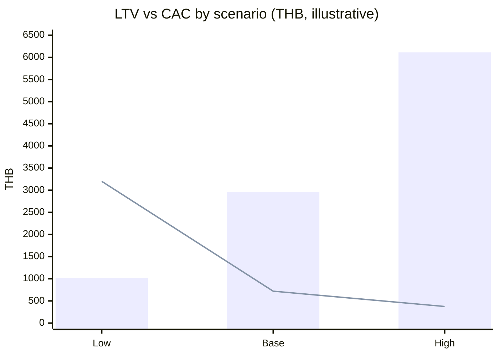

DRAFT — requires Product Owner review; numbers are assumptions unless cited.

# 04 — Unit Economics (CAC / LTV / Gross Margin / Payback)

| Field | Value |
|---|---|
| Project | FamilyGuardian AI (FGAI-2026-001) |
| Date | 2026-11-05 |
| Status | DRAFT v0.1. **Illustrative model. No figure here is a fact or a forecast.** |

> Every input below is an **[Estimate]** or **[Hypothesis]**, apart from the payment-fee reference points, which come from a published price list and are still labelled **to verify with provider**. We have no customers, no churn data and no CAC data. The purpose is to show **which assumptions matter most** and what has to be true for the business to work.

Unit of analysis: **one paying family** (one subscription covering one senior plus their family members) per month. Currency: THB.

---

## 1. Assumptions table (all inputs)

| ID | Input | Low (pessimistic) | Base | High (optimistic) | Label | Rationale / how to validate |
|---|---|---|---|---|---|---|
| A1 | Family Care price (VAT-inclusive, monthly) | ฿199 | ฿199 | ฿199 | [Hypothesis] | Pricing hypothesis; test with Van Westendorp / fake door (`03` §2) |
| A2 | Guardian Plus price (VAT-inclusive, monthly) | ฿349 | ฿349 | ฿349 | [Hypothesis] | As above |
| A3 | Share of payers on Family Care (rest on Guardian Plus) | 85% | 70% | 60% | [Estimate] | Pilot tier mix |
| A4 | VAT rate removed from the price | 7% | 7% | 7% | [Hypothesis] that prices include VAT and we are VAT-registered | **Verify with a tax advisor** |
| A5 | Blended payment cost, % of gross price | 8.0% | 3.0% | 2.0% | [Estimate] | Base ≈ a mix of PromptPay (Omise lists 1.65%) and card (3.65%) at https://www.omise.co/pricing/thailand, **to verify with provider**. Low assumes some sales go through app-store IAP (commission **to verify with Apple/Google**). High assumes a negotiated rate |
| A6 | Variable cost to serve per paying family/month (hosting, notifications, support, human help amortised) | ฿60 | ฿35 | ฿20 | [Estimate] | Measure in the pilot; human help is the biggest unknown |
| A7 | Free (non-paying) families per paying family | 9 | 4 | 2 | [Estimate] | Equivalent to free→paid conversion of 10% / 20% / 33% of the active base |
| A8 | Cost to serve one free family/month | ฿3.0 | ฿2.0 | ฿1.5 | [Estimate] | Hosting + notifications only |
| A9 | Monthly churn of paying families | 10.0% | 6.0% | 3.5% | [Estimate] | Pilot months 1–3; consumer subscription churn varies widely |
| A10 | Paid-acquisition cost per new registered family (signup) | ฿200 | ฿120 | ฿90 | [Estimate] | Fake-door ad test (cost per signup) |
| A11 | Signup→paid conversion (paid-acquired cohort) | 5% | 10% | 12% | [Estimate] | Pilot / fake door |
| A12 | Share of new payers that come from paid acquisition (rest organic or referral at ~zero marginal cost) | 80% | 60% | 50% | [Estimate] | Referral tracking |
| A13 | Fixed operating cost per month (team, compliance, tooling), for the break-even view only | ฿300,000 | ฿300,000 | ฿300,000 | [Estimate] | Placeholder; replace with the real budget |
| A14 | Discount rate | not applied | not applied | not applied | Simplification | LTV is **undiscounted**, which flatters long lifetimes |

---

## 2. Formulas

```
ARPU_gross        = A3 × A1 + (1 − A3) × A2
ARPU_net (ex-VAT) = ARPU_gross ÷ (1 + A4)
Payment cost      = ARPU_gross × A5
Free-user subsidy = A7 × A8
Gross margin (GM) per paying family / month = ARPU_net − Payment cost − A6 − Free-user subsidy
GM %              = GM ÷ ARPU_net
Lifetime (months) = 1 ÷ A9
LTV (gross-margin based, undiscounted) = GM ÷ A9
Blended CAC       = (A10 ÷ A11) × A12
LTV : CAC         = LTV ÷ CAC
Payback (months)  = CAC ÷ GM
Break-even paying families = A13 ÷ GM
```

---

## 3. Scenario results (calculations shown)

| Step | Low (pessimistic) | Base | High (optimistic) |
|---|---|---|---|
| ARPU_gross | 0.85×199 + 0.15×349 = **฿221.50** | 0.70×199 + 0.30×349 = **฿244.00** | 0.60×199 + 0.40×349 = **฿259.00** |
| ARPU_net | 221.50 ÷ 1.07 = **฿207.01** | 244.00 ÷ 1.07 = **฿228.04** | 259.00 ÷ 1.07 = **฿242.06** |
| Payment cost | 221.50 × 8% = **฿17.72** | 244.00 × 3% = **฿7.32** | 259.00 × 2% = **฿5.18** |
| Cost to serve (A6) | ฿60.00 | ฿35.00 | ฿20.00 |
| Free-user subsidy | 9 × 3.0 = **฿27.00** | 4 × 2.0 = **฿8.00** | 2 × 1.5 = **฿3.00** |
| **GM / paying family / month** | 207.01 − 17.72 − 60 − 27 = **฿102.29** | 228.04 − 7.32 − 35 − 8 = **฿177.72** | 242.06 − 5.18 − 20 − 3 = **฿213.88** |
| GM % | 102.29 ÷ 207.01 = **49.4%** | 177.72 ÷ 228.04 = **77.9%** | 213.88 ÷ 242.06 = **88.4%** |
| Lifetime | 1 ÷ 0.10 = **10.0 months** | 1 ÷ 0.06 = **16.7 months** | 1 ÷ 0.035 = **28.6 months** |
| **LTV** | 102.29 ÷ 0.10 = **฿1,022.9** | 177.72 ÷ 0.06 = **฿2,962.0** | 213.88 ÷ 0.035 = **฿6,110.7** |
| **Blended CAC** | (200 ÷ 0.05) × 0.80 = **฿3,200.0** | (120 ÷ 0.10) × 0.60 = **฿720.0** | (90 ÷ 0.12) × 0.50 = **฿375.0** |
| **LTV : CAC** | 1,022.9 ÷ 3,200 = **0.32** | 2,962.0 ÷ 720 = **4.11** | 6,110.7 ÷ 375 = **16.30** |
| **Payback** | 3,200 ÷ 102.29 = **31.3 months** | 720 ÷ 177.72 = **4.1 months** | 375 ÷ 213.88 = **1.8 months** |
| Break-even paying families (A13 ÷ GM) | 300,000 ÷ 102.29 = **2,933** | 300,000 ÷ 177.72 = **1,689** | 300,000 ÷ 213.88 = **1,403** |

All results are **[Estimate]**s derived from the assumptions above.

### 3.1 Reading the scenarios
- **Low:** LTV:CAC is below 1 and payback (31 months) is longer than the expected lifetime (10 months). Each paying family **loses money**. This happens if paid ads are the main channel, conversion is low and human help is expensive. [Estimate]
- **Base:** LTV:CAC ≈ 4 and payback ≈ 4 months, which is healthy **if** churn really is ≈ 6%/month. [Estimate]
- **High:** LTV:CAC ≈ 16 is unrealistically good and should be treated as an upper bound. Do not pitch it. [Estimate]


(Bars = LTV, line = CAC. Illustrative only.)

---

## 4. Sensitivity: which assumption matters most?

Holding the other base inputs constant:

| Change one input | New value | Result | Calculation |
|---|---|---|---|
| Churn needed for LTV:CAC = 3 | **8.2% / month** | Above this, base fails the 3:1 rule of thumb | LTV needed = 3 × 720 = 2,160 → churn = 177.72 ÷ 2,160 = 0.0823 |
| Churn rises to 10% | 10% | LTV = 177.72 ÷ 0.10 = ฿1,777; LTV:CAC = 2.47 | — |
| Conversion falls to 5% | 5% | CAC = (120 ÷ 0.05) × 0.6 = ฿1,440; LTV:CAC = 2.06; payback = 8.1 months | 1,440 ÷ 177.72 |
| Cost to serve doubles to ฿70 | ฿70 | GM = 228.04 − 7.32 − 70 − 8 = ฿142.72; LTV = ฿2,378.7; LTV:CAC = 3.30 | — |
| All sales via app-store IAP (fee 15–30%, **to verify with Apple/Google**) | 15% | Payment cost = 244 × 0.15 = ฿36.60; GM = 228.04 − 36.60 − 35 − 8 = ฿148.44; LTV:CAC = 3.44 | ÷ 0.06 ÷ 720 |
| Price cut to ฿149 / ฿299 (same mix) | — | ARPU_gross = 0.7×149 + 0.3×299 = ฿194.00; net ฿181.31; payment ฿5.82; GM = 181.31 − 5.82 − 35 − 8 = ฿132.49; LTV:CAC = 3.07 | — |

**Conclusion [Estimate]:** the model is most sensitive to **churn** and **free→paid conversion**, then to **cost to serve** (human help). Price matters less than retention within the ฿149–199 range.

---

## 5. B2B2C illustration (one contract)

| Input | Value | Label |
|---|---|---|
| Enrolled families | 500 | [Estimate] |
| Licence price per enrolled family / month (ex-VAT) | ฿80 | [Estimate] |
| Cost to serve per family / month | ฿25 | [Estimate] |
| Sales + onboarding cost to win the contract | ฿150,000 | [Estimate] |
| Contract length | 12 months | [Estimate] |

- Monthly GM = 500 × (80 − 25) = **฿27,500**
- Contract GM over 12 months = 27,500 × 12 = **฿330,000**
- Payback on the sales cost = 150,000 ÷ 27,500 = **5.5 months**
- Contract LTV:CAC = 330,000 ÷ 150,000 = **2.2** (before renewal)

All [Estimate]. Enrolment rate within the employer (what share of eligible employees actually activate) is a key unknown.

---

## 6. What to measure first (pilot instrumentation)
1. Trial→paid conversion (A11) and the organic share (A12).
2. Month-1 to month-3 churn (A9).
3. Human-help contacts per Guardian Plus family per month → cost to serve (A6).
4. Real gateway quote for PromptPay vs card, and recurring support (A5), **to verify with provider**.
5. Free:paid ratio and notification cost per free family (A7, A8).
