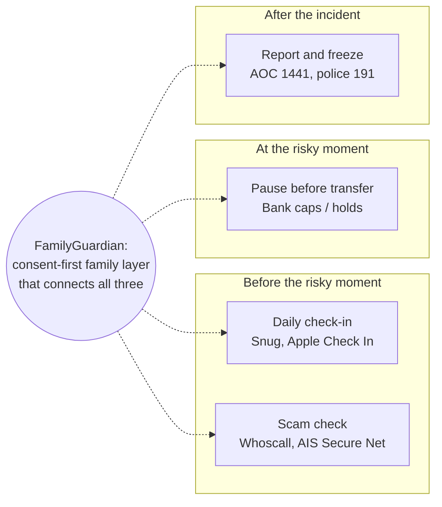

DRAFT — requires Product Owner review; numbers are assumptions unless cited.

# 05 — Competitor and Alternatives Landscape

| Field | Value |
|---|---|
| Project | FamilyGuardian AI (FGAI-2026-001) |
| Date / access date for all URLs | **2026-11-05** |
| Method | Web search and page fetches on 2026-11-05. Where we opened the page ourselves, it says "fetched". Where we only saw a search-result summary, it says "search result". Prices change and differ by country, so **re-check before quoting.** |

Labels: **[Evidence]** (URL, accessed 2026-11-05), **[Hypothesis]**, **[Unverified]** (we found the claim but could not confirm it from a primary source).

---

## 1. Summary matrix

| Alternative | Category | Scam check | Pre-transfer pause | Daily check-in | Family sharing | Senior-controlled consent | Human help | Price (public) |
|---|---|---|---|---|---|---|---|---|
| Whoscall (Gogolook) | Caller ID / anti-scam app | ✓ calls, SMS, URL | — | — | Family plan (up to 5 accounts) | n/a | — | Reported 59 THB/mo or 599 THB/yr (older source) |
| AOC 1441 (DES ministry) | Government hotline | Via phone report | — | — | — | n/a | ✓ (hotline) | Free |
| Bank app protections (BOT measures) | Bank controls | Malware and overlay detection | Transfer caps, biometrics, holds | — | — | n/a | Bank call centre | Free to customers |
| AIS Secure Net / 1185 | Telco network protection | Blocks dangerous sites; report numbers | — | — | — | n/a | 1185 hotline | Secure Net free (older source); Secure Net+ price not found |
| Apple Check In (iOS 17+) | OS feature | — | — | Trip/timer based | 1:1 contact | User chooses data level | — | Free (iOS only) |
| Life360 | Family location | Some tiers include ID-theft features [Unverified for TH] | — | Location-based | ✓ Circle | Location-centric | Tiered | US$/region-dependent; conflicting figures |
| Snug Safety | Daily check-in (US) | — | — | ✓ | Emergency contacts | — | Paid "Dispatch" tier | Free; paid tier reported $20/mo |
| Medisafe | Medication reminders | — | — | — | "Medfriend" | — | — | Premium about $4.99/mo; TH store 1-yr ฿1,490 [Unverified] |
| MyTherapy | Medication reminders | — | — | Health diary | Share with doctor | — | — | Free; optional ad-free subscription |
| Thai elderly-care platforms (NSTDA Well-Living/LANAH, others) | Care coordination / research | — | — | Some | Caregiver-focused | Unclear | Some | Mostly research or B2B; no consumer price found |
| **FamilyGuardian (intended)** | Integrated | ✓ explain, never "safe" | ✓ 4-question pause | ✓ voluntary, 6 options | ✓ per category × member × expiry | **✓ core** | Guardian Plus | ฿0 / 199 / 349 [Hypothesis] |

---

## 2. Profiles

### 2.1 Whoscall (Gogolook), scam / caller-ID app
- **Features:** caller ID, number search, URL scanner (free); premium adds automatic spam-call blocking, automatic database updates and SMS filtering.
  - [Evidence] free basics: https://www.rcbc.com/whoscall (a Philippines bank FAQ, so it may not reflect the Thai tier exactly). Search result.
  - [Evidence] Thai campaign listing premium features: https://brandinside.asia/siam-commercial-bank-customers-can-download-whoscall-premium-for-free. Search result.
- **Plans:** Premium Individual, Duo and Family (up to 5 people), announced 14 Oct 2025; one account per device. Local prices for Thailand are on the Thai site and **were not visible to us in text**. [Evidence, fetched]: https://www.whoscall.com/en/blog/articles/2088-Introducing%20Whoscall%20Premium%20Duo%20&%20Family-%20Share%20Your%20Shield,%20Protect%20Your%20Circle
- **Price (Thailand):** 59 THB/month or 599 THB/year as reported by the Bangkok Post. **The article is older, so current pricing is unverified.** [Evidence]: https://www.bangkokpost.com/life/tech/2323406/gogolook-chooses-thailand-to-be-its-new-regional-hub. The Nation (June 2022) also reported "from THB599 per year": https://www.nationthailand.com/tech/40016485
- **Distribution:** bank partnership. SCB customers could get Whoscall Premium free for 6 months through SCB EASY. [Evidence]: https://brandinside.asia/siam-commercial-bank-customers-can-download-whoscall-premium-for-free
- **Gap FamilyGuardian targets [Hypothesis]:** Whoscall protects the **individual's phone** (calls and SMS). It has no daily well-being check-in, no pre-transfer reflection, and no senior-controlled sharing of *context* (e.g. "Mum checked a suspicious message and wants you to call"). **Positioning: a complement, not a replacement.** A Whoscall user could still use FamilyGuardian for the family layer. Partnership potential (P2).

### 2.2 AOC 1441, government Anti-Online Scam Operation Center
- **What it is:** a one-stop service from the Ministry of Digital Economy and Society (DES) with the Royal Thai Police and partner agencies, launched around 1 Nov 2023. The 1441 hotline runs 24/7. [Evidence]: https://www.prd.go.th/th/content/category/detail/id/9/iid/228754 ; https://thethaiger.com/news/national/thailands-aoc-launched-to-tackle-rising-online-scams
- **Reported results (ministry figures, not independently verified):** over 340,000 suspicious accounts suspended in its first year. [Evidence]: https://thailand.prd.go.th/en/content/category/detail/id/2078/iid/340595
- **Price:** free public service.
- **Gap [Hypothesis]:** AOC acts **after** a scam is suspected or has happened (reporting, freezing accounts). FamilyGuardian works **before** that moment (explain, pause, ask family) and **routes users to 1441**. It never claims to file a report (scope §3.2). **Positioning: a feeder to the official channel, not a substitute.** The 1441 number still needs human verification in the directory (B4).

### 2.3 Bank app protections and Bank of Thailand measures
- **Measures reported (2025):** a near-real-time detection system that can temporarily hold suspicious transactions; biometric checks for opening app-based accounts and for transfers above 50,000 baht. [Evidence]: https://www.nationthailand.com/business/banking-finance/40055630
- Daily mobile transfer caps announced in August 2025 for new customers, with existing customers to follow. [Evidence]: https://fintech.global/2025/08/21/thailand-caps-daily-transfers-to-curb-rising-scams/
- Mobile banking security tightened (malware and remote-control defences; minimum OS versions). [Evidence]: https://www.nationthailand.com/business/banking-finance/40046130
- Mass temporary suspensions of suspected mule accounts in September 2025 caught some innocent users, and authorities moved to speed up unlocking. [Evidence]: https://www.khaosodenglish.com/news/2025/09/15/thai-authorities-scramble-to-fix-scammer-crackdown-gone-wrong/
- **Bank-specific features (KBank, SCB, etc.):** **not verified.** We found no primary source for individual bank features in this pass. Do not cite any.
- **Price:** free to bank customers.
- **Gap [Hypothesis]:** bank controls are **transaction- and device-centric** and exist within one bank. They don't involve the family by the senior's choice, and they don't help with a scam *conversation* that happens before the transfer (e.g. a fake police call). FamilyGuardian's Guardian Pause is **not connected to any bank** (scope exclusion). Banks are a potential **B2B2C partner** (P2) rather than a direct competitor.

### 2.4 AIS Secure Net and the 1185 hotline (telco)
- AIS Secure Net is described as a **free** service to protect against spam, phishing and viruses for mobile and home internet customers. [Evidence], search result, may be outdated: https://brandinside.asia/?p=196813
- The free 1185 hotline lets customers report scam calls and SMS. [Evidence]: AIS sustainability news item 243, "AIS takes on cyber-criminals and protects customers with first free 1185 hotline in Thailand" (search result; not fetched): https://sustainability.ais.co.th/en/update/news/243/ais-takes-on-cyber-criminals-and-protects-customers-with-first-free-1185-hotline-in-thailand-%E0%B8%A8%E0%B8%B9%E0%B8%99%E0%B8%A2%E0%B9%8C%E0%B8%A3%E0%B8%B1%E0%B8%9A%E0%B9%80%E0%B8%A3%E0%B8%B7%E0%B9%88%E0%B8%AD%E0%B8%87%E0%B8%A3%E0%B9%89%E0%B8%AD%E0%B8%87%E0%B9%80%E0%B8%A3%E0%B8%B5%E0%B8%A2%E0%B8%99%E0%B9%80%E0%B8%9A%E0%B8%AD%E0%B8%A3%E0%B9%8C%E0%B9%82%E0%B8%97%E0%B8%A3%E0%B9%81%E0%B8%A5%E0%B8%B0-sms-%E0%B8%A1%E0%B8%B4%E0%B8%88%E0%B8%89%E0%B8%B2%E0%B8%8A%E0%B8%B5%E0%B8%9E-ais-spam-report-center-%E0%B8%9C%E0%B8%99%E0%B8%B6%E0%B8%81%E0%B8%81%E0%B8%B3%E0%B8%A5%E0%B8%B1%E0%B8%87-%E0%B8%95%E0%B8%B3%E0%B8%A3%E0%B8%A7%E0%B8%88%E0%B9%84%E0%B8%8B%E0%B9%80%E0%B8%9A%E0%B8%AD%E0%B8%A3%E0%B9%8C-%E0%B8%A3%E0%B8%B1%E0%B8%9A%E0%B9%81
- Secure Net+ "Protected by MSIG" bundles cyber insurance. **We could not find its price.** [Evidence for existence]: https://www.msig-thai.com/th/node/1356
- Other operators (True, NT) likely have similar services. **Not researched.**
- **Gap [Hypothesis]:** network-level blocking for the **subscriber**, with no family layer or well-being element. A potential **bundle partner** (telcos are in our B2B2C list).

### 2.5 Apple Check In (iOS 17+)
- Lets a user notify a contact when they arrive. If they don't respond, it can share location, battery and signal details. Both people need iOS 17. [Evidence]: https://www.macrumors.com/how-to/use-check-in-feature-ios-messages/ ; https://tidbits.com/2023/10/09/ios-17s-check-in-feature-provides-peace-of-mind-and-could-even-save-lives/
- **Price:** free with iOS.
- **Gap [Hypothesis]:** trip-based and iPhone-only. In Thailand, Android is likely the majority among seniors [Hypothesis, unverified]. No scam features, and no recurring daily well-being check-in for older adults.

### 2.6 Life360 (family location)
- Free tier plus Silver/Gold/Platinum memberships. **Prices conflict across regional pages**, so we don't quote a single figure. [Evidence]: https://www.life360.com/plans-pricing-ap ; https://intl.life360.com/plans-pricing
- **Thai availability and pricing:** not verified.
- **Gap [Hypothesis]:** built around **location tracking**, which FamilyGuardian deliberately excludes (scope §3.2: coercive-surveillance risk). This is the clearest contrast for "Protect Without Controlling".

### 2.7 Snug Safety (daily check-in, US)
- Free daily check-in. If the user misses it, the app texts emergency contacts with the last known location. A paid "Dispatch" plan was reported at $20/month or $200/year (a column from March 2026; our sources conflict on the details). [Evidence]: https://gazette.com/2026/03/10/savvy-senior-is-your-aging-parent-safe-at-home/ ; App Store listing: https://apps.apple.com/us/app/snug-safety/id1122758716
- **Not available or localised for Thailand** as far as we found [Unverified].
- **Gap [Hypothesis]:** it proves there is demand for "are you OK today?" check-ins. It has no scam layer, no Thai language, and is location-based on a missed check-in.

### 2.8 Medication-reminder apps
- **Medisafe:** premium about $4.99/month or $39.99/year (third-party review). Premium adds unlimited "Medfriend" supporters and family profiles. The Thai App Store reportedly lists a 1-year premium at ฿1,490 [Unverified: search snippet; page not opened]. Reports conflict on whether a 2026 paywall limits the free tier. [Evidence]: https://apps.apple.com/th/app/id573916946 ; https://pillo.care/blog/pillo-vs-medisafe-comparison (written by a competitor, so possibly biased)
- **MyTherapy:** the developer says it is free and will stay free. Reminders, refill alerts, a health diary and sharing with a doctor; optional ad-free subscription. [Evidence]: https://apps.apple.com/th/app/id662170995 ; https://healthify.nz/apps/m/mytherapy-meds-pill-reminder-app
- **Gap [Hypothesis]:** reminders are a **commodity** and largely free. FamilyGuardian should treat reminders as a point of parity (P1), not a reason to pay.

### 2.9 Thai elderly-care and caregiver platforms
- NSTDA "Well-Living Systems" / LANAH App: an AI-based elderly-care system for families. At the time of the source it was experimental, with field tests planned. [Evidence]: https://thailand.go.th/event-detail/001_05_026
- Other Thai efforts we found as search results only (**not verified**: status, pricing and scale unknown): NSTDA "Nirun for Community" (LINE-based caregiver tool), Health at Home (caregiver matching), Genstar/CareAdviser, Ayasan Cares (caregiver agency), plus academic prototypes. One related source: https://www.nationthailand.com/tech/30289656 (we did not confirm which product it describes).
- Academic literature notes that few mobile apps serve Thai elderly people and their caregivers. [Evidence], search result: https://ejournal.lucp.net/index.php/mjn/article/view/2222
- **Gap [Hypothesis]:** these focus on **care delivery and caregivers**, not on scam protection or senior-owned consent. They are possible partners (caregiver agencies as a channel).

### 2.10 Police community programmes
- The Thai Cyber Police launched a "Senior's Club" to fight online scams. [Evidence]: https://tna.mcot.net/english-news-1489964
- **Relevance:** a channel and partner for awareness, not a competitor.

### 2.11 "Do nothing" / LINE groups (the real incumbent)
- Families already use LINE group chats and phone calls [Hypothesis; very likely but uncited]. This is free, familiar and needs no new app.
- **Implication [Hypothesis]:** our biggest competitor is **habit**. FamilyGuardian must fit around LINE (e.g. LINE OA notifications, P2) rather than replace it.

---

## 3. Gap analysis: where FamilyGuardian fits

| Gap | Who leaves it open | FamilyGuardian response | Label |
|---|---|---|---|
| No single place where the **family** sees **context the senior chooses to share** | All point tools | Consent matrix + family dashboard | [Hypothesis] that families value it |
| No plain-Thai **explanation** of *why* a message is risky, with uncertainty | Caller-ID apps label; they don't teach | ScamShield evidence + "never safe" wording | [Hypothesis] |
| No **pause** for a scam conversation that happens before the transfer | Banks act on transactions | Guardian Pause (no bank link) | [Hypothesis] on effectiveness |
| Trackers create a **surveillance** feel | Location apps | No location, no call or SMS reading | Product principle |
| Official help is **reactive** | AOC 1441 | Route to 1441 with honest labels | — |

## 4. Competitive risks
1. **Bundling by incumbents:** a bank or telco adds a "family alert" feature for free [Hypothesis]. Mitigation: become their B2B2C partner.
2. **Whoscall Family plan** expands into family features [Hypothesis]. Mitigation: differentiate on well-being, Guardian Pause and consent.
3. **Free is enough:** LINE plus free apps may satisfy most families [Hypothesis]. Test in WTP research (`03`).

## 5. Not verified in this pass (to do)
- Current Whoscall Thai prices for Individual, Duo and Family.
- Each Thai bank's in-app anti-scam features (from the bank's own sites).
- True and NT telco anti-scam products and prices.
- Secure Net+ price.
- Life360 availability and pricing in Thailand.
- Status of Nirun, Health at Home and other Thai platforms.
- The NSO percentage of 60+ smartphone users.
