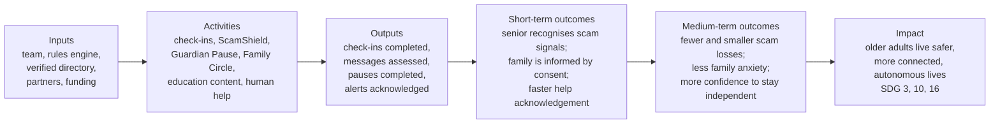

DRAFT — requires Product Owner review; numbers are assumptions unless cited.

# 06 — Social and Environmental Impact Framework

| Field | Value |
|---|---|
| Project | FamilyGuardian AI (FGAI-2026-001) |
| Date | 2026-11-05 |
| Status | DRAFT v0.1. **No impact has been measured yet.** Every outcome is a [Hypothesis] until the pilot reports data. |

Labels: **[Evidence]** (URL, accessed 2026-11-05), **[Hypothesis]**, **[Estimate]**.

---

## 1. Problem evidence (baseline context)

| Issue | Evidence | Label |
|---|---|---|
| Ageing society | About 20% of Thais aged 60+ in 2024 (NSO figure as reported): https://nationthailand.com/thailand/policies/40037391 | [Evidence] |
| Financial harm from scams to seniors | About 14,000 senior-related cases and about 4.4 billion THB in losses in 2024 (CCIB data via VNA): https://en.vietnamplus.vn/thai-police-step-up-efforts-to-protect-senior-citizens-from-cyber-scams-post310138.vnp | [Evidence], news report |
| Digital divide | About 58% of 60+ Thais used the internet in Q3 2023: https://statista.com/statistics/1472650/thailand-share-of-elderly-people-who-use-the-internet | [Evidence], secondary |
| Loneliness linked to romance-scam vulnerability | https://thethaiger.com/news/national/older-adults-vulnerable-to-online-romance-scams-due-to-loneliness | [Evidence], news; causality not established |

---

## 2. Theory of change

**Key assumptions in the chain [Hypothesis]:**
1. Seniors will check suspicious messages **before** acting (behaviour change at the moment of risk).
2. A short pause and a family conversation reduce compliance with scam pressure.
3. Consent-first design keeps seniors engaged rather than feeling surveilled.
4. Families respond to acknowledged alerts within a useful time window.

**Risks to the theory of change (possible negative impacts):**
- **False reassurance:** a "low signals" result read as "safe". Mitigation: never say "safe" (S-04).
- **Coercive control** by a family member. Mitigation: the senior owns all grants; no location tracking; "who viewed my info" log.
- **Over-alerting** that causes anxiety. Mitigation: neutral labels and no "decline" for missing data.
- **Exclusion** of low-digital seniors. Mitigation: family-assisted setup; B2B2C channels; large-tile UI.

---

## 3. Outcome indicators

| Level | Indicator | Definition | Data source | Baseline | Target (pilot) | Label |
|---|---|---|---|---|---|---|
| Output | Weekly active seniors | Seniors with ≥ 1 check-in or scam check in 7 days | App analytics (aggregate) | 0 | ≥ 70% of enrolled | [Estimate] |
| Output | Scam checks per active senior / month | Count | App | 0 | — (observe) | — |
| Output | Guardian Pause sessions completed | Count, and % ending in "stop and verify" | App | 0 | — (observe) | — |
| Short-term | Scam-recognition score | Correct classification of 10 synthetic test messages, before vs after 4 weeks | Pre/post quiz | Measure at onboarding | +20 percentage points | [Hypothesis] |
| Short-term | Help acknowledgement time | Median minutes from a help request to the first acknowledgement | App | Measure | < 15 min | [Estimate] |
| Medium-term | Self-reported scam loss | Any money lost to a scam in the past 3 months (yes/no, amount band) | Survey (sensitive; voluntary) | Measure at onboarding | Directional decrease only; the sample is too small for a causal claim | [Hypothesis] |
| Medium-term | Family worry | A validated or adapted worry scale for adult children (instrument TBD) | Survey | Measure | Decrease | [Hypothesis] |
| Medium-term | Senior autonomy / feeling in control | A 5-point Likert scale: "I decide what my family sees" | Survey | Measure | ≥ 80% agree | [Hypothesis] |
| Safeguard | Revocations and "feels like surveillance" reports | Count and qualitative themes | App + interviews | — | Monitored, not targeted | — |

**Attribution caution:** a 30-family pilot without a control group **cannot prove** that scam losses fell. Report the outcomes as **directional**, and propose a larger controlled study later.

---

## 4. SDG mapping

| SDG | Target (UN) | FamilyGuardian contribution | Indicator link | Label |
|---|---|---|---|---|
| **SDG 3** Good health and well-being | 3.4 (promote mental health and well-being) | Voluntary well-being check-ins; less family anxiety; **no diagnosis** | Family worry, autonomy | [Hypothesis] |
| **SDG 10** Reduced inequalities | 10.2 (social and economic inclusion of all, irrespective of age) | Senior-friendly Thai UX; inclusion in digital safety | Weekly active seniors aged 70+ | [Hypothesis] |
| **SDG 16** Peace, justice and strong institutions | 16.4 (combat organised crime / illicit financial flows) | Scam awareness; routing to official 1441 / 191 | Scam-recognition score; referrals to 1441 (self-reported) | [Hypothesis] |
| SDG 17 (secondary) | 17.17 (partnerships) | B2B2C and public partnerships | Number of partners | [Hypothesis] |

SDG target wording should be checked against https://sdgs.un.org/goals before publication (not fetched in this pass).

---

## 5. Environmental footprint: boundary and approach

**We make no claim of carbon neutrality, "green" or "net zero" status.** A software service has a small but real footprint.

### 5.1 Measurement boundary (proposed)

| In scope (operational) | Out of scope for v1 (stated explicitly) |
|---|---|
| Cloud compute, database and storage for staging/production (Scope 3, category 1: purchased services) | Manufacturing of users' phones (Scope 3, embodied) |
| Data transfer from our servers | Users' device electricity |
| Notification delivery (push, email; SMS if added) | Team commuting, offices (until there is a team) |
| CI/CD runs | Partner systems (gateway, app stores) |

### 5.2 Method
- Use the cloud provider's carbon reporting tool where one is available, or an estimate of **kWh × the region's grid emission factor** with the source of the factor cited. Report as **kg CO₂e per active family per year** [method; figures to be measured].
- State the region (a Thai/SEA region is preferred for data residency, B6) and the factor's source and year.
- Report once a year, with uncertainty ranges.

### 5.3 Reduction practices (no offset claims)
- Right-size instances and scale to zero in staging.
- Batch notifications; no unnecessary polling.
- Retention limits already cut stored data (raw scam text deleted after 30 days; check-ins after 12 months; architecture §5).
- Rules engine first (ADR-006): the optional LLM explainer stays off by default (B2), which avoids model inference energy.
- If offsets are ever bought, report them **separately** from emissions and do not describe the result as "neutral".

---

## 6. Impact governance
- Measurement plan reviewed by an advisor (ENT501 faculty) before the pilot.
- Survey items with sensitive data (scam losses, well-being) need explicit consent (PDPA s.26 likely applies, B5).
- Publish an annual impact note with methods, limitations and negative findings.
