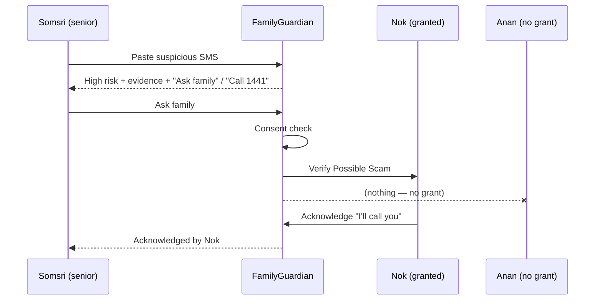

DRAFT — requires Product Owner review; numbers are assumptions unless cited.

# ENT501: FamilyGuardian AI, 18-Slide Pitch Outline

| Field | Value |
|---|---|
| Project | FamilyGuardian AI (FGAI-2026-001) |
| Date | 2026-11-05 |
| Status | DRAFT v0.1 |
| Sources | `docs/business/01`–`06`, `docs/product/01_DISCOVERY_AND_SCOPE.md`, `docs/architecture/03_ARCHITECTURE.md` |

**Evidence rule for this deck:** each slide's "Evidence to show" is split into
- 🟩 **Validated / cited** = a public source with a URL (accessed 2026-11-05), or a fact about what the prototype does.
- 🟨 **Hypothesis / estimate** = not yet tested with users. It must be visibly labelled on the slide (e.g. a yellow "Hypothesis" tag).

No user research has been completed, so **no slide may say that customers want, pay for, or love the product.**

---

### Slide 1: Title
- **FamilyGuardian AI**: "Care Beyond Distance. Protect Without Controlling."
- A consent-first family safety companion for older adults in Thailand
- Team name, ENT501, date
- Status: MVP prototype with synthetic data only

**Speaker notes:** Open with the promise. Say plainly that this is an early-stage venture with a working prototype and hypotheses to test, not a launched product.
**Evidence to show:** 🟩 Product prototype screenshot (synthetic demo account "Somsri"). 🟨 none.

### Slide 2: The problem (seniors)
- Thailand is an ageing society: about 1 in 5 people are 60+
- Older Thais are targeted by scammers posing as bank or police staff
- Senior-related online fraud losses were reported at about 4.4 bn THB in 2024
- Many seniors don't want to "bother" busy children (hypothesis)

**Speaker notes:** Separate the facts (first three bullets, cited) from the insight we still need to validate (fourth bullet).
**Evidence to show:** 🟩 https://nationthailand.com/thailand/policies/40037391 (≈20% aged 60+); 🟩 https://en.vietnamplus.vn/thai-police-step-up-efforts-to-protect-senior-citizens-from-cyber-scams-post310138.vnp (≈14,000 cases, ≈4.4 bn THB, 2024; news report of CCIB data); 🟩 https://thethaiger.com/news/national/elderly-thais-targeted-by-scammers-posing-as-bank-agents. 🟨 "Not wanting to bother children" = hypothesis.

### Slide 3: The problem (families)
- Adult children often live far away and worry daily (hypothesis)
- Today's choices are calling repeatedly, or surveillance apps that seniors resent (hypothesis)
- Help arrives only after money is gone: hotlines and freezes are reactive
- The gap: no consent-based way to share context *before* the risky moment

**Speaker notes:** The emotional core. Stress that "tracking" damages dignity, and that this is why we exclude location tracking.
**Evidence to show:** 🟩 AOC 1441 is a post-incident reporting and freezing service: https://thailand.prd.go.th/en/content/category/detail/id/2078/iid/340595. 🟨 Family worry and surveillance resentment = hypotheses (planned interviews, `01` §7).

### Slide 4: Our solution
- **FeelSense:** a voluntary 6-option daily check-in (including "prefer not to say")
- **ScamShield:** plain-Thai risk explanation with evidence; **never says "safe"**
- **Guardian Pause:** a 4-question reflection before any money transfer (no bank connection)
- **Family Circle:** the senior grants what each person sees, and can revoke in one tap
- **Help:** one-tap call and a help request with honest delivery status

**Speaker notes:** Each feature solves a pain from slides 2–3. Mention the product rules: no diagnosis, no fake case numbers, and no "call connected" claims.
**Evidence to show:** 🟩 Feature list and acceptance criteria from the scope doc (S-02…S-09). 🟨 Effectiveness of the features = hypothesis.

### Slide 5: How it works (demo flow)
- 1) Somsri receives a "bank officer" SMS → pastes it into ScamShield
- 2) The result: "High risk", with evidence quotes, an uncertainty note, "Ask family" and "Call 1441"
- 3) She taps "Ask family" → Nok (granted scam_checks) is notified → Nok acknowledges
- 4) Anan (zero grants) sees nothing, which shows consent enforcement
- 5) Guardian Pause: 2+ risk answers → calm warning → Stop & Verify

**Speaker notes:** A live demo from synthetic accounts (somsri@demo.fg, nok@demo.fg, anan@demo.fg). Have a backup video if the demo fails.
**Evidence to show:** 🟩 Live prototype or recorded demo (synthetic data, labelled). 🟨 none.

### Slide 6: Why now
- The demographic shift is under way (aged → super-aged society projected)
- Regulators are tightening bank-app security and transfer controls, so scams shift to social engineering
- Smartphone and internet use among 60+ is rising (≈58% online in 2023)
- A rules-first design means we can launch without expensive AI or bank integrations

**Speaker notes:** Regulation makes "pre-transfer conversation" more important, because technical attacks get harder. Note the inference in bullet 2 is ours.
**Evidence to show:** 🟩 https://www.nationthailand.com/business/banking-finance/40055630 (BOT measures); 🟩 https://statista.com/statistics/1472650/thailand-share-of-elderly-people-who-use-the-internet; 🟩 https://ipsr.mahidol.ac.th/wp-content/uploads/2025/01/Gazette2025EN.pdf. 🟨 "Scams shift to social engineering" = our inference (hypothesis).

### Slide 7: Target customers (STP)
- Beachhead: Bangkok adult children (30–55) with a parent aged 65–80 who uses LINE
- User = senior (data owner); payer = adult child
- Secondary: employers and insurers (B2B2C)
- Positioning: consent-first, integrated, "Protect Without Controlling"

**Speaker notes:** Explain the two-sided household. Show the value proposition canvas briefly.
**Evidence to show:** 🟩 Population context (slide 2 sources). 🟨 The segment choice and its size = hypothesis (`01_stp_value_proposition.md`).

### Slide 8: Value proposition
- Adult children: reassurance in 10 seconds, an early "verify scam" signal, fair sibling sharing
- Seniors: control, plain-Thai explanations, a face-saving reason to pause
- B2B2C: an aggregate-only family-wellbeing benefit (k ≥ 10)
- Not offered on purpose: location, reading SMS or LINE, diagnosis

**Speaker notes:** Read the pains and gains from the canvas. The "not offered" list is part of the value.
**Evidence to show:** 🟨 The entire canvas is hypothesis until interviews (n = 15–20 adult children, 10–15 seniors).

### Slide 9: Competition
- Whoscall: caller ID and SMS filter (individual phone)
- AOC 1441 and bank controls: reactive, transaction-focused, free
- Location trackers: surveillance model; medication apps: commodity and free
- Our gap: the consent-first **family layer** that connects check-in, scam check, pause and help

**Speaker notes:** Present competitors as complements and partners where possible (Whoscall, banks, telcos). The real incumbent is "LINE group + phone calls".
**Evidence to show:** 🟩 https://www.whoscall.com/en/blog/articles/2088-Introducing%20Whoscall%20Premium%20Duo%20&%20Family-%20Share%20Your%20Shield,%20Protect%20Your%20Circle; 🟩 https://www.bangkokpost.com/life/tech/2323406/gogolook-chooses-thailand-to-be-its-new-regional-hub (59 THB/mo, older figure); 🟩 https://www.life360.com/plans-pricing-ap; 🟩 https://apps.apple.com/th/app/id662170995. 🟨 The perceptual map position = hypothesis (`05_competitor_landscape.md`).

### Slide 10: Business model
- Freemium: Free ฿0 · Family Care ฿199/mo · Guardian Plus ฿349/mo (**hypotheses**)
- Safety basics stay free (emergency numbers, help request, basic scam check)
- B2B2C licences: employers, insurers, banks, telcos, hospitals
- No data selling, no ads using sensitive data

**Speaker notes:** Pricing is a hypothesis to test with Van Westendorp, a fake door and the pilot. Context: Whoscall was ≈59 THB/mo, so we must deliver family-level value.
**Evidence to show:** 🟩 The Whoscall price point (slide 9 URL). 🟨 All FG prices = hypothesis (`03_revenue_payment_strategy.md`).

### Slide 11: Payments and platform rules
- Web PWA first → hosted checkout via an authorised gateway: PromptPay, card, TrueMoney, ShopeePay
- Published gateway fees exist (e.g. PromptPay 1.65%, card 3.65% + VAT) but are **to verify with provider**
- Native apps (P2): Apple/Google in-app purchase rules apply to digital subscriptions
- TikTok/Shopee/Lazada = acquisition channels with their own rules, not guaranteed subscription outlets

**Speaker notes:** This shows maturity: we know the platform constraints before we build native apps. Payments are sandbox-only in the MVP.
**Evidence to show:** 🟩 https://www.omise.co/pricing/thailand; 🟩 https://developer.apple.com/app-store/review/guidelines/ (3.1.1, 3.1.3(b)); 🟩 https://support.google.com/googleplay/android-developer/answer/10281818?hl=en. 🟨 Recurring support for local methods = to verify.

### Slide 12: Unit economics (illustrative)
- Base: GM ≈ ฿178 per paying family per month (≈78%), LTV ≈ ฿2,962, CAC ≈ ฿720
- Base LTV:CAC ≈ 4.1, payback ≈ 4 months; pessimistic case LTV:CAC 0.3 (fails)
- The business works only if monthly churn stays below ≈ 8%
- Most sensitive to churn → conversion → human-help cost

**Speaker notes:** Show the low/base/high table and say aloud: "These are assumptions, not forecasts." Highlight the failure case honestly.
**Evidence to show:** 🟨 All figures are [Estimate]s (`04_unit_economics.md` §1–4). 🟩 Only the fee inputs reference a published price list (to verify).

### Slide 13: Go-to-market
- Phase 1: community trust (elderly clubs, police senior programmes, universities) + family-assisted setup
- Phase 2: scam-awareness content on social video and LINE OA → web checkout
- Phase 3: B2B2C pilots with 1–2 employers or insurers; telco and bank bundles
- Referral loop: each senior invites 1–3 family members

**Speaker notes:** CAC is the risk in the pessimistic case, so we lead with partnerships and organic channels.
**Evidence to show:** 🟩 The police Senior's Club exists: https://tna.mcot.net/english-news-1489964. 🟨 Channel effectiveness and referral rate = hypothesis.

### Slide 14: Social impact
- Theory of change: awareness → pause → family conversation → fewer and smaller losses
- Indicators: scam-recognition score, help acknowledgement time, autonomy score
- SDG 3 (well-being), SDG 10 (inclusion of older people), SDG 16 (combat organised crime)
- Environmental: a defined measurement boundary; **no carbon-neutral claim**

**Speaker notes:** A 30-family pilot gives directional results only and cannot prove causality. Name the negative-impact risks (false reassurance, coercive control).
**Evidence to show:** 🟩 Baseline problem data (slide 2). 🟨 All outcomes = hypothesis (`06_social_environmental_impact.md`).

### Slide 15: Ethics, privacy and safety
- The senior owns all sharing: category × member × expiry, with one-tap revoke
- Never "safe", no diagnosis, no emotion inference, no claims that an agency was notified
- PDPA: health-related check-ins are likely sensitive data → explicit consent; legal review before the pilot
- Security: hosted checkout only, HMAC webhooks, audit log, admin sees no private content

**Speaker notes:** Trust is the product. Show the consent matrix screen and the "who viewed my info" log.
**Evidence to show:** 🟩 Product rules and architecture (scope §3.2, architecture §5–6); prototype screen. 🟨 That users perceive it as trustworthy = hypothesis.

### Slide 16: Roadmap
- P0 (now): MVP prototype: check-in, ScamShield, Guardian Pause, Family Circle, alerts (synthetic data)
- P1: reminders and care tasks, sandbox billing, admin, export and delete, hardening
- P2: native app (IAP), real gateway, LINE OA notifications, partner APIs (bank, telco, caller-ID)
- Gates: SCOPE ✓ → DESIGN → ARCH → QA → UAT → RELEASE

**Speaker notes:** SCOPE was approved on 2026-11-05. DESIGN and ARCH are not yet signed. Be precise about status.
**Evidence to show:** 🟩 `docs/decisions/DECISIONS_LOG.md`; backlog increments INC-0…INC-5. 🟨 Timeline dates = estimates.

### Slide 17: Pilot plan (proposal)
- 30 families (senior + at least 1 adult child) over 8 weeks, with consent and an ethics process
- Measure: weekly active use, scam-recognition pre/post, acknowledgement time, trial→paid, churn
- WTP: Van Westendorp (n ≥ 100) + fake-door A/B (฿149/199/249) before the pilot
- Go/no-go: e.g. ≥ 70% weekly active, ≥ 25% trial→paid, month-2 retention ≥ 80%

**Speaker notes:** The pilot is a proposal (B3) and needs PDPA review (B5) and a gateway contract before real charges. Until then, sandbox billing and intent-to-pay.
**Evidence to show:** 🟨 All thresholds are proposed estimates (`03` §2, `06` §3).

### Slide 18: Team and the ask
- Team: founder (Product Owner) + AI-assisted engineering workflow; roles to fill: Thai UX researcher, PDPA advisor
- Ask 1: introductions to 2 employers or insurers for B2B2C pilots
- Ask 2: access to elderly clubs / communities for interviews (with consent)
- Ask 3: an independent QA and security reviewer + an ethics advisor

**Speaker notes:** Close on the promise. Be honest that the team is small and the gates require independent human review (B1). State any funding ask only once the budget is confirmed by the Product Owner.
**Evidence to show:** 🟩 Gate model and signatory blocker B1 (scope doc). 🟨 Team plan and funding needs = to be confirmed.

---

## Appendix: claims checklist before presenting
- [ ] Every number on a slide carries either a URL or a "Hypothesis / Estimate" tag.
- [ ] Re-check the Whoscall Thai price and the gateway fees on presentation day.
- [ ] Official numbers 1441 / 191 / 1669 verified by a human (B4) before they are shown as verified.
- [ ] The demo uses synthetic accounts only and says so on screen.
