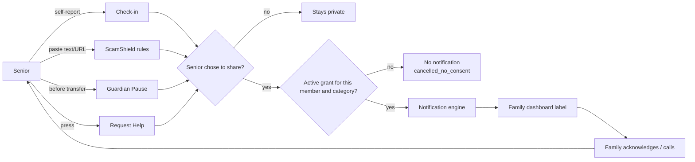

DRAFT — evidence vs hypothesis labelled; requires Product Owner review

# FamilyGuardian AI — Product Requirements Document (v0.1)

| Field | Value |
|---|---|
| Project ID | FGAI-2026-001 |
| Owner of this doc | Product & Research Agent (draft) |
| Date | 2026-11-05 |
| Human approver | Product Owner (founder) |
| Source of truth for scope | `docs/product/01_DISCOVERY_AND_SCOPE.md` (SCOPE gate approved 2026-11-05, see `docs/decisions/DECISIONS_LOG.md`). **If this PRD and the scope doc disagree, the scope doc wins** until the PO amends it. |
| Related | `04_UX_SPEC.md`, `../safety/02_THREAT_MODEL.md`, `../architecture/03_ARCHITECTURE.md`, `../research/*` |

**Label key.** [Evidence] = backed by a cited external source or by a decision already recorded in this repo. [Hypothesis] = a belief we still have to test. [Estimate] = a number we made up for planning, not measured.

**Brand promise:** *Care Beyond Distance. Protect Without Controlling.* (ดูแลได้แม้อยู่ไกล ปกป้องโดยไม่ควบคุม: draft Thai, needs native-speaker review)

---

## 1. Problem

### 1.1 Context
- [Evidence] As reported by Nation Thailand (citing the National Statistical Office), Thailand had **13.64 million people aged 60+ in 2023, 19.5% of the population**. Source: https://nationthailand.com/thailand/policies/40037391 (20 Apr 2024).
- [Evidence, secondary, not checked against the primary NSO report] As reported by Thai PBS World (republished on LINE Today), a 2024 NSO survey found **12.9% of older people live alone**, up from 3.6% in 1994. Source: https://today.line.me/th/v3/article/l2G30VB
- [Evidence] As reported by The Thaiger (citing Royal Thai Police data presented by a deputy government spokesperson), **365,547 online-scam complaints with about 45.7 billion baht in damage** were filed from 1 Mar 2022 to 30 Sep 2023. Source: https://thethaiger.com/hot-news/crime/thai-online-fraud-cases-soar-to-365000-with-45-billion-baht-loss-2 (6 Oct 2023).
- [Evidence, survey method not stated in the article] As reported by The Star (citing a Global Anti-Scam Alliance report), **Thais lost about 110 billion baht to scams in the past year, and 60% said they had been scammed**. Source: https://www.thestar.com.my/aseanplus/aseanplus-news/2025/11/12/us339bil-lost-to-scams-in-thailand-in-past-year-six-in-10-fall-victim-to-fraudsters (12 Nov 2025).
- **Gap:** we found **no reliable aggregate statistic for scam losses among older Thais specifically**. We do not claim that older adults lose more than other age groups. Finding or producing such data is research question RQ-1.

### 1.2 Problem statement
[Hypothesis] Older adults in Thailand who live apart from their families face two linked problems:
1. **Scam exposure without a timely second opinion.** Scams depend on urgency, secrecy and impersonation, and the person who could help (an adult child) is far away or busy.
2. **Quiet isolation.** Families want to know "is Mum okay?", but the tools available tend to be either intrusive (location tracking, camera) or easy to ignore (group chat).

The tools that exist tend to make families choose between **care** and **autonomy**. FamilyGuardian aims for both: the senior stays the owner of every piece of data, and family members see only what the senior chooses to share.

---

## 2. Goals and non-goals

### 2.1 Goals (MVP = local/staging demo with synthetic data, per assumption A2)
| # | Goal | Measured by (see §7) |
|---|---|---|
| G1 | A senior can check a suspicious message or pause before a transfer **without help**, and gets an honest, explainable result | Unaided task completion in UAT |
| G2 | A senior can share well-being and safety information **selectively**, and can take it back at any time | Grant/revoke completion; authz test matrix |
| G3 | Family members get **actionable, calm** signals (four approved labels only) and can acknowledge them | Time to acknowledge; label-accuracy tests |
| G4 | The system **never overstates** what it did or knows (no "safe", no diagnosis, no claim that an agency was notified) | Forbidden-phrase test; healthcare safety review |
| G5 | The product is ready for a well-governed **30-family pilot proposal** | `docs/research/06_*` and `07_*` approved |

### 2.2 Non-goals (from scope §3.2, restated)
- Reading, intercepting or blocking real bank transactions, OTPs or bank credentials.
- Automatic reporting to police, hospitals, banks or the AOC, and any case or receipt numbers.
- Emotion inference from voice, text or behaviour; depression screening; any diagnosis.
- Location tracking, call recording, reading SMS or LINE, monitoring social media.
- Server-side fetching of submitted URLs; screenshot OCR (P1 option, on-device preferred).
- Real payments, native apps, production deployment.
- Being a medical device. The product is positioned as a **non-diagnostic wellness and safety tool**. This positioning must be confirmed by an expert (see `docs/research/07_*` §10).

---

## 3. Users

| Role | Persona (fictional, see `docs/research/01_*`) | Primary need | Access model |
|---|---|---|---|
| Senior (owner) | Khun Somsri, 72, lives alone in Nakhon Ratchasima | Independence, a quick second opinion, an easy way to reach people | Owns all data and all grants |
| Family member | Nok, 41, daughter in Bangkok | To know when to act without nagging or spying | Sees only granted categories, each with an expiry |
| Caregiver | Pim, 34, part-time carer | Clear tasks and a way to respond to help requests | Can never hold `scam_checks` or `transfer_pauses` [Evidence: `CAREGIVER_FORBIDDEN` in `packages/shared/src/domain.ts`] |
| Admin | Operator | To run the service without seeing private content | No content access |
| Org admin (P2 stub) | B2B partner | Aggregate figures only (k ≥ 10) | No individual data |
| Anti-persona | Coercive relative ("wants full visibility") | — | The design must **resist** this user (threat T1) |

---

## 4. Modules A–I

> **Note on letters:** the directive's module list is not stored in this repo. The A–I mapping below comes from the "Mod" references in scope §3.1 and the screen inventory, and **the PO must confirm it**.

| Mod | Name | Summary | Priority | Increment |
|---|---|---|---|---|
| A | **Daily check-in** (working name "FeelSense", see the naming issue in `08_*`) | Voluntary self-report with 6 options including "ไม่อยากตอบ", an optional note, a sharing choice for each check-in, and a personal history | **P0** | INC-1 |
| B | **Connect**: trusted contacts and one-tap call | `tel:` call with the honest log "เริ่มโทรจากแอป" | **P0** | INC-1 |
| C | **Care reminders and tasks** | Medication or appointment reminders (Taken / Skip / Remind later); caregiver task completion | **P1** | INC-4 |
| D | **ScamShield** | Text, URL string or phone number → rules engine → risk category, reasons with evidence, uncertainty, verification steps, Ask family / Call 1441 | **P0** | INC-2 |
| E | **Guardian Pause** | Amount plus 4 yes/no questions → calm warning and 4 actions; no bank connection | **P0** | INC-2 |
| F | **Family Circle and consent** | Invite (link plus 6-digit code), per-member × per-category grants with expiry, revoke, "who viewed" log | **P0** | INC-3 |
| G | **Emergency and assistance** | Request Help to chosen contacts; directory of 1669 / 191 / 1441 with verification status | **P0** | INC-1 |
| H | **Family dashboard and status labels** | Four approved labels only, neutral styling when data is missing | **P0** | INC-3 |
| I | **Notification and alert engine** | Signal → rule → consent check → notify → ack → follow-up, with honest delivery states | **P0** | INC-3 |
| — | Billing (sandbox), admin, export/delete | Support functions | P1 | INC-4 |
| — | AI explainer for ScamShield | LLM can only *raise* risk or explain; off by default (B2 = rules only) | P1 (flagged) | — |
| — | On-device OCR, bank-partner integration, verified agency APIs, native app, caller ID | Need partners or extra privacy work | **P2** | — |

### 4.1 Priority rationale
- **P0** = needed to show the brand promise end to end: a senior acts safely on their own (A, B, D, E, G), and shares with consent (F, H, I).
- **P1** = useful for the pilot but adds sensitive data (C: health reminders) or operational load.
- **P2** = depends on outside partners, legal review or native platforms.

---

## 5. Requirements

### 5.1 Functional requirements (P0)
The story IDs refer to scope §4. This section adds product-level rules; it does not repeat the acceptance criteria.

| ID | Requirement | Mod | Story |
|---|---|---|---|
| FR-A1 | The check-in is optional every day. Skipping it never creates an alert or a negative status | A | S-02, F-02 |
| FR-A2 | "ไม่อยากตอบ" has the same visual weight as the other options | A | S-02 |
| FR-A3 | The history shows only self-reported entries. Gaps read "ไม่มีข้อมูล". There is no score, no slope and no "decline" wording | A | S-03 |
| FR-A4 | A neutral, always-visible line points to help: "หากรู้สึกไม่สบายหรือฉุกเฉิน โทร 1669". It is the same for every answer, not triggered by the answer | A | — (new; see `08_*`) |
| FR-B1 | The call log records only "call started from app" | B | S-06 |
| FR-D1 | ScamShield has no "safe" category. The lowest result is `low_signals` with "ยังควรตรวจสอบ" | D | S-04 |
| FR-D2 | Every result shows the evidence (quoted fragments), what we are unsure about, and next steps | D | S-04 |
| FR-D3 | Submitted URLs are analysed as strings only and shown as non-clickable text | D | T6 |
| FR-D4 | Help numbers in results come only from the verified directory, never from free text or AI output | D, G | T3 |
| FR-E1 | Guardian Pause never implies that a transfer was blocked or reported | E | S-05 |
| FR-E2 | A "keep it secret" answer alone is enough to trigger the warning | E | S-05 |
| FR-F1 | Grants can only be created from the senior's own session, with re-authentication | F | S-09, T1, T9 |
| FR-F2 | Every grant expires (default 90 days, max 365) | F | T1 |
| FR-F3 | When a grant is revoked or expires, the family sees the same neutral text ("no longer shared"), so a revoke is not singled out | F | F-03, T1 |
| FR-F4 | New members start with zero grants, and onboarding has no pre-ticked boxes | F | F-01, T2 |
| FR-F5 | The senior gets a private, periodic prompt to review sharing | F | T1 |
| FR-G1 | No screen states or implies that an agency received a report | G | S-08, T5 |
| FR-G2 | If no one acknowledges a help request, the senior sees "ยังไม่มีผู้รับทราบ — หากเร่งด่วนโทร 1669" | G, I | S-07 |
| FR-H1 | "Check In Recommended" comes only from a shared, self-reported Lonely or Worried, never from missing data | H | UX §5 |
| FR-H2 | "No Action Needed" carries a sub-line making clear it reflects **only what the senior shared** (see `08_*` issue HS-03) | H | — (new) |
| FR-I1 | Consent is checked both when a notification is queued and when it is delivered | I | Arch §4 |
| FR-I2 | Notification bodies are minimal on the lock screen | I | T7 |

### 5.2 Non-functional requirements
| Area | Requirement | Source |
|---|---|---|
| Accessibility | WCAG 2.2 AA; 20px base font; targets ≥ 56 px; no timed interactions | UX §2 |
| Language | Thai first, English second. Thai copy reviewed by a native speaker and by 2–3 older adults before the DESIGN gate | A9 |
| Privacy | Data minimisation, PDPA-oriented design, explicit consent for sensitive categories (to be confirmed by a qualified reviewer) | Threat model §5, `07_*` |
| Security | 0 open critical/high findings at the QA gate | Gates |
| Honesty | Forbidden-phrase test over all copy | `labels.ts` |
| Offline / no AI | ScamShield works without any AI provider | A4 |
| Data | Synthetic data only until the legal review (B5) is done | A2, B5 |

---

## 6. Key flows (summary)

---

## 7. Success metrics

All targets below are **proposed targets, not outcomes**. Nothing has been measured. The pilot measurement methods are in `docs/research/06_pilot_plan_30_families.md`.

| Metric | Type | Proposed target | Stage |
|---|---|---|---|
| Unaided completion of each P0 senior task | Usability | ≥ 80% of senior testers (proposal from backlog §9) | UAT |
| Change in scam-recognition test score (baseline → day 30) | Outcome | Statistically meaningful improvement; size set by the PO after the baseline | Pilot |
| Seniors who say they "feel in control of what my family sees" (5-point, ≥ 4) | Autonomy | ≥ 80% | Pilot |
| Median time from help request to first acknowledgement | Responsiveness | Report the measured value; no target until the baseline | Pilot |
| Seniors who used revoke or "only me" at least once | Agency signal (a healthy sign, not a failure) | Report only | Pilot |
| ScamShield recall on scam cases / false-positive rate on benign cases (eval set) | Model quality | Measured, never claimed in advance (backlog §9) | QA |
| Forbidden-phrase violations | Safety | 0 | QA |
| Safety incidents caused by the product (false reassurance, a missed alert presented as sent) | Safety | 0, with every incident reviewed | Pilot |
| 30-day retention (active in week 4) | Engagement | [Estimate] ≥ 60%, purely for planning | Pilot |

We deliberately **do not** optimise for daily check-in streaks or daily active use. Doing so would push people to share more than they want to (see `04_*`).

---

## 8. Risks

| # | Risk | Likelihood / impact [Estimate] | Mitigation |
|---|---|---|---|
| R1 | A coercive relative uses the app for control (T1) | Med / High | Only the senior can grant; expiry; neutral revoke; private review prompt; no location |
| R2 | False reassurance from ScamShield or "No Action Needed" | Med / High | No "safe" category; uncertainty shown; sub-line on the dashboard |
| R3 | Being classed as a medical device because of health or mood features | Low–Med / High | Non-diagnostic copy; no inference; expert screening (`07_*` §10) |
| R4 | PDPA non-compliance for sensitive data | Med / High | Explicit, granular, versioned consent; legal review before any real pilot (B5) |
| R5 | Low engagement because seniors find it a chore | Med / Med | Optional check-ins; no streaks; 6 tiles; co-design with older adults |
| R6 | A tampered help directory sends seniors to a scammer | Low / High | Admin-only edits with a source URL and an audit trail (T3) |
| R7 | Alert fatigue among family members | Med / Med | Four labels only; signals come from explicit actions, not inference |
| R8 | Thai copy misunderstood (tone, register) | Med / Med | Native-speaker and older-adult review (A9) |
| R9 | Founder signs most gates, so review independence is weak (B1) | High / Med | Independent read-only agent review plus a named human reviewer |

---

## 9. Open questions

1. **(PO)** Does the A–I module mapping in §4 match the directive?
2. **(PO)** Where is the canonical list of directive §14 pilot metrics? `06_*` proposes a set that must be reconciled with it.
3. **(Legal/DPO)** Which categories are "sensitive data" under PDPA s.26? Are self-reported moods "health data"? Is a scam check or a Guardian Pause sensitive in practice even if not in law?
4. **(Regulatory expert)** Does a voluntary mood check-in plus medication reminders stay outside Thai FDA software-as-a-medical-device rules?
5. **(Research)** Is there any reliable Thai data on scam victimisation by age? If not, can the pilot baseline survey help fill the gap ethically?
6. **(UX)** Should the check-in module drop the "FeelSense" name (`08_*` HS-01)?
7. **(Business)** Is the pricing hypothesis (Free / ฿199 / ฿349 / B2B, A10) tested in the pilot or separately?
8. **(Safety)** Which crisis-support line (for example the Department of Mental Health hotline) should go in the static help line, after human verification?
