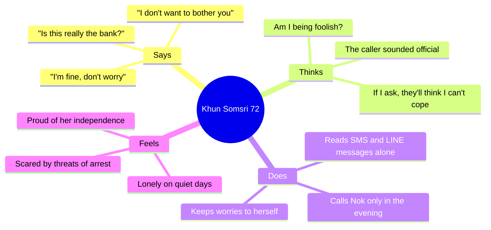

DRAFT — evidence vs hypothesis labelled; requires Product Owner review

# 01 — Personas and Empathy Map

> **All personas are fictional composites.** None is a real person, and no interviews have been done yet. Every attitude, quote and behaviour below is a **[Hypothesis]** to be tested in discovery interviews and the pilot (`06_*`), unless it is marked [Evidence] with a source. The names match the synthetic demo accounts (`docs/decisions/AGENT_BRIEF_COMMON.md`) so the team uses one shared language.

Context facts used to ground the personas:
- [Evidence] As reported by Nation Thailand (citing the NSO), 13.64 million Thais were aged 60+ in 2023 (19.5% of the population), and 5.11 million older people (37.5%) were still working. https://nationthailand.com/thailand/policies/40037391
- [Evidence, secondary, not checked against the primary report] As reported by Thai PBS World via LINE Today, 12.9% of older people lived alone in 2024 (NSO survey). https://today.line.me/th/v3/article/l2G30VB

---

## Persona 1: Khun Somsri (คุณสมศรี), 72, senior and data owner

| | |
|---|---|
| Lives | Alone, in a town house in Nakhon Ratchasima, since her husband died 3 years ago |
| Family | Daughter Nok in Bangkok (≈ 260 km away); son Anan abroad for work |
| Tech | Android phone, uses LINE every day for stickers and video calls with her grandchild; does not use mobile banking on her own, but her daughter set up PromptPay for her |
| Health | Takes blood-pressure tablets; goes to the provincial hospital every 3 months |
| Values | Being independent, not being a burden (ไม่อยากเป็นภาระลูก), her temple community, her dignity |
| Scam exposure [Hypothesis] | Gets SMS messages about "parcel stuck at customs" and calls from "officials" saying her account is linked to money laundering |

**Quotes (fictional):**
- "แม่ไม่อยากโทรไปกวนลูกทุกเรื่อง ลูกทำงานยุ่ง" ("I don't want to bother my daughter with every little thing. She's busy.")
- "ถ้ามีคนโทรมาบอกว่าเป็นตำรวจ แม่ก็กลัวนะ" ("If someone calls saying they're the police, of course I get scared.")
- "อยากให้ลูกรู้ว่าแม่สบายดี แต่ไม่อยากให้ใครมาคอยดูทุกอย่าง" ("I want my daughter to know I'm okay, but I don't want anyone watching everything I do.")

**Goals:** to know quickly whether a message is a trick; to reach Nok easily; to feel useful, not watched.
**Frustrations:** small text, English menus, apps that keep changing; being treated as incapable.
**What success looks like:** "I checked it myself, then I called Nok, and she said I did the right thing."

---

## Persona 2: Nok (นก), 41, adult daughter living far away

| | |
|---|---|
| Lives | Bangkok condo with her husband and a 9-year-old son; works in marketing |
| Contact with mum | LINE call 2–3 times a week; visits monthly |
| Fear [Hypothesis] | That her mother will be pressured into a large transfer in one phone call; that something will happen and nobody will know for days |
| Tension | She wants to know more, but knows her mother hates being "checked on" |

**Quotes (fictional):**
- "ไม่ได้อยากสอดส่องแม่ แค่อยากรู้ว่าตอนไหนควรโทรหา" ("I don't want to spy on Mum. I just want to know when I should call.")
- "กลัวที่สุดคือแม่โอนเงินไปแล้วค่อยมาบอก" ("My biggest fear is that she transfers the money and only tells me afterwards.")
- "กลุ่มไลน์ครอบครัวมีข้อความเยอะจนพลาดเรื่องสำคัญ" ("The family LINE group has so many messages that the important ones get lost.")

**Goals:** clear, calm signals; one place to respond; not becoming the "police" of the family.
**Frustrations:** alert noise, guilt, not knowing who else has already responded.

---

## Persona 3: Pim (พิม), 34, part-time caregiver

| | |
|---|---|
| Role | Visits Khun Somsri three mornings a week; paid by Nok; also cares for two other older clients |
| Tech | Smartphone; comfortable with apps |
| Needs | Clear tasks, an easy way to record what she did, and a way to respond to "help" requests |
| Boundaries | Should **not** see finances or scam checks (enforced by `CAREGIVER_FORBIDDEN`) [Evidence: `packages/shared/src/domain.ts`] |

**Quotes (fictional):**
- "อยากรู้แค่ว่าวันนี้ต้องทำอะไรบ้าง แล้วบอกได้ว่าทำแล้ว" ("I just want to know what I need to do today, and be able to say I've done it.")
- "เรื่องเงินของคุณยายไม่ใช่เรื่องของพิม พิมไม่อยากถูกสงสัย" ("Grandma's money isn't my business. I don't want to be suspected.")

**Goals:** to be trusted, avoid blame, and have clear role boundaries.

---

## Anti-persona: the controlling relative (not designed *for*; designed *against*)
A fictional relative who wants all of the senior's data "for her own good" and pressures her to grant everything. The product must make that hard: only the senior grants access, grants expire, a revoke looks the same as an expiry, and the senior gets a private review prompt (threat model T1). See `07_*` §6.

---

## Empathy map: Khun Somsri (primary)

| Quadrant | Content [all Hypothesis] |
|---|---|
| **Says** | "สบายดีจ้ะ ไม่ต้องห่วง" (I'm fine, don't worry). "This is a bank number, isn't it?" "I don't want to trouble anyone." |
| **Thinks** | "If I ask too often, my children will think I'm getting old and foolish." "The man knew my name, so he must be real." "Nobody will notice if I'm unwell today." |
| **Does** | Answers unknown numbers; reads SMS links; hides small mistakes; watches TV news about scams; goes to the temple on holy days |
| **Feels** | Lonely in the evenings; anxious and rushed when threatened; embarrassed after a near-miss; warm when the grandchild calls |
| **Pains** | Time pressure from scammers; small fonts; jargon; fear of being judged; family far away; not knowing which number is real |
| **Gains** | A fast, private second opinion; a one-tap way to reach Nok; feeling capable; control over what is shared; being thanked rather than scolded |

## Empathy map: Nok (secondary)

| Quadrant | Content [all Hypothesis] |
|---|---|
| **Says** | "แม่อย่าโอนเงินให้ใครนะ" (Mum, don't transfer money to anyone). "Call me if anything looks strange." |
| **Thinks** | "Am I a bad daughter for living far away?" "If I install tracking, Mum will be upset." |
| **Does** | Calls in the evening; forwards scam-warning posts to the family group; checks LINE "last seen" |
| **Feels** | Guilt, low-level worry, relief after each call |
| **Pains** | Not knowing when to act; finding out too late; noisy group chats; being cast as the "controller" |
| **Gains** | Calm signals that only appear when something matters; knowing whether a sibling has already responded; a better relationship with Mum |

## Empathy map: Pim (tertiary)

| Quadrant | Content [all Hypothesis] |
|---|---|
| **Says / Thinks** | "I need clear instructions." "I don't want to be blamed if something goes missing." |
| **Does / Feels** | Juggles several clients; uses paper notes; feels responsible but under-recognised |
| **Pains / Gains** | Unclear expectations, versus a clear task list, a record of completed work and firm role boundaries |

---

## Research questions these personas raise
1. Do older adults see a "scam check" as a sign of competence (good) or of incompetence (stigmatising)?
2. How do Thai families handle the "ไม่อยากเป็นภาระ" (not wanting to be a burden) norm when asking for help?
3. Do adult children accept *not* seeing everything?
4. Are paid caregivers in Thailand usually informal, and what is their digital access like?
