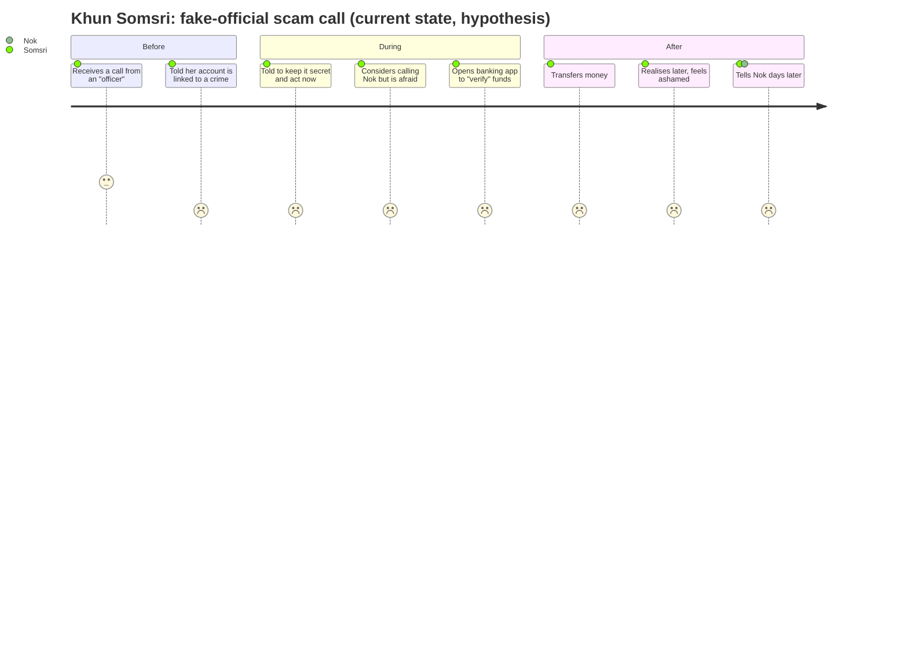
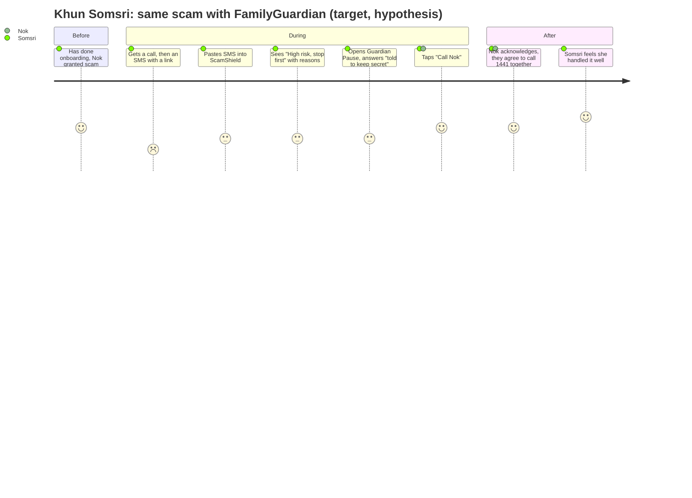
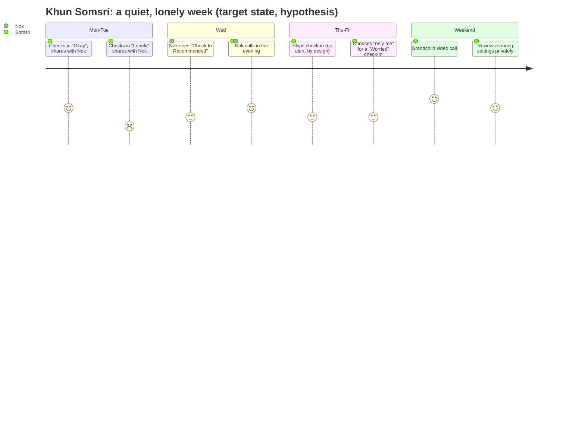
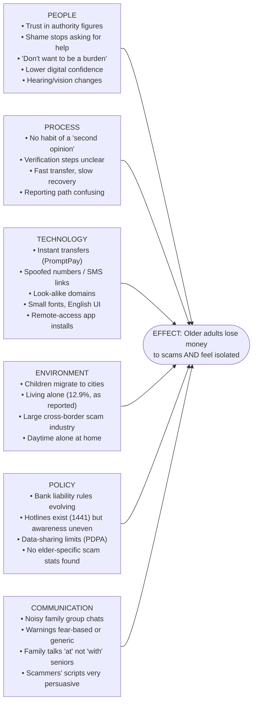

DRAFT — evidence vs hypothesis labelled; requires Product Owner review

# 02 — Customer Journey Maps and Fishbone (Ishikawa) Analysis

> The journeys are **[Hypothesis]** scenarios built from the fictional personas in `01_*`. They are not observed behaviour. Emotion scores (1 = very negative, 5 = very positive) are illustrative.

---

## Journey 1: a scam attempt, without and with FamilyGuardian

### 1a. Today (no product): "fake police" call-centre scam

### 1b. With FamilyGuardian (target state)

| Stage | Senior action | Touchpoint | Thought/feeling [Hypothesis] | Pain point | Product opportunity (Mod) | What we must NOT do |
|---|---|---|---|---|---|---|
| Before | Normal day | Phone | Calm | Doesn't know common scam scripts | Onboarding examples; optional learn cards (P1) | Fear-based marketing |
| Trigger | Unknown call or SMS | Phone/SMS | Startled | Authority and urgency | — | — |
| During: doubt | Hesitates | ScamShield (D) | "Is this real?" | No one to ask right now | Fast paste-and-check; reasons with evidence | Say "safe" |
| During: pressure | Asked to transfer | Guardian Pause (E) | Panic, secrecy | Secrecy cuts her off from help | The "secret" question triggers the warning; Call family | Imply a transfer was blocked |
| During: reach out | Calls family | Connect (B) | Relief | Family busy | One tap; honest call log; Request Help (G) | Claim the call connected |
| After | Decides what to do | Emergency screen (G) | Shame or pride | Unsure who to report to | 1441 / bank (verified directory) | Claim an agency was told |
| After: family | Nok sees label | Dashboard (H), alerts (I) | Nok: worried, then relieved | Too late, or noise | "Verify Possible Scam" label, acknowledgement visible to the senior | Show more detail than granted |

---

## Journey 2: a lonely week

| Day | What happens | Design rule shown |
|---|---|---|
| Mon | "Okay", shared | Default is the standing grant; can pick "only me" |
| Tue | "Lonely", shared | A self-reported, shared signal → "Check In Recommended" (UX §5) |
| Wed | Nok calls | The label suggests a gentle action ("ลองทักทายดูนะ"), not an emergency |
| Thu | No check-in | Missing data is never an alert; it shows neutrally as "ยังไม่มีการเช็กอินวันนี้" |
| Fri | "Worried", only me | The senior can keep feelings private without having to explain |
| Sat | Video call | The app is a bridge, not a replacement for human contact |
| Sun | Privacy review | A private prompt shown only to the senior (T1) |

**Key insight [Hypothesis]:** the product helps most when it **lowers the cost of a small reach-out** ("ลองทักทาย") rather than trying to detect a crisis. It cannot detect a crisis, and it must not suggest that it can.

---

## Fishbone (Ishikawa): "Older adults lose money to scams and feel isolated"

Mermaid has no native Ishikawa type, so the diagram below uses a left-to-right flowchart: each category is a bone, and its causes are listed inside.

| Category | Cause | Label | Note / source | Product response |
|---|---|---|---|---|
| People | Trust in authority figures; fear when threatened | [Hypothesis], supported by anecdote | A Chiang Rai Times article reports an official saying older people "tend to believe the first message they receive": https://chiangraitimes.com/news/unscrupulous-call-centre-gangs-targeting-the-elderly-in-thailand (anecdotal, not a study; quote taken from a search-result summary and not re-read in full) | ScamShield names the "impersonation" and "threat_or_fear" signals explicitly |
| People | Shame and "ไม่อยากเป็นภาระ" stop help-seeking | [Hypothesis] | To test in interviews | Framing that rewards checking ("checking is smart") |
| Process | No routine second opinion before a transfer | [Hypothesis] | — | Guardian Pause |
| Process | Unclear reporting path after a scam | [Hypothesis] | — | Emergency screen with verified 1441, 191, 1669 |
| Technology | Instant transfers, mule accounts | [Evidence] | As reported by The Thaiger (Royal Thai Police data), 167,347 mule accounts holding 11.25 billion baht were suspended between Mar 2022 and Sep 2023: https://thethaiger.com/hot-news/crime/thai-online-fraud-cases-soar-to-365000-with-45-billion-baht-loss-2 | Pause *before* the transfer; no bank integration in the MVP |
| Technology | Inaccessible UIs | [Hypothesis] | — | WCAG 2.2 AA, 20px base font, Thai first |
| Environment | Living alone is rising | [Evidence, secondary] | 12.9% in 2024, as reported by Thai PBS World via LINE Today: https://today.line.me/th/v3/article/l2G30VB | Connect, check-in, Request Help |
| Environment | Very large scam losses overall | [Evidence] | About 110 billion baht in the past year and 60% scammed, as reported by The Star citing GASA: https://www.thestar.com.my/aseanplus/aseanplus-news/2025/11/12/us339bil-lost-to-scams-in-thailand-in-past-year-six-in-10-fall-victim-to-fraudsters | — |
| Policy | Hotline exists but awareness varies | [Evidence] for the hotline, [Hypothesis] for awareness | AOC 1441 sources are listed in the threat model §7 | Promote 1441 in results |
| Policy | No age-disaggregated scam statistics found | [Evidence of absence in our search, 2026-11-05] | — | RQ-1; pilot baseline survey |
| Communication | Generic, fear-based warnings | [Hypothesis] | — | Explain the *why* using the message's own words |
| Communication | Signals lost in group chats | [Hypothesis] | — | Four calm labels; acknowledgement visible to all |

**Root-cause hypothesis to test first:** *secrecy plus urgency cuts the senior off from trusted people at the decisive moment.* Guardian Pause and one-tap Connect target exactly that link in the chain.
