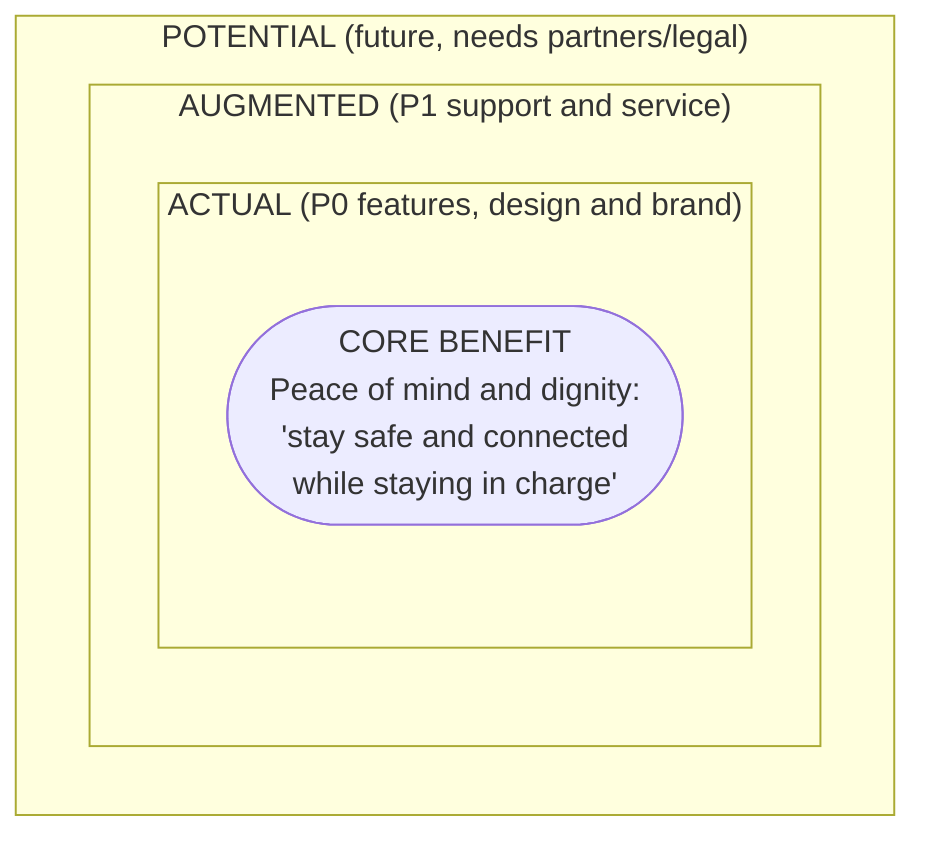

DRAFT — evidence vs hypothesis labelled; requires Product Owner review

# 05 — Product Levels (Core / Actual / Augmented / Potential)

> This document uses Kotler's levels-of-product framework. Placement in each level is a **[Hypothesis]** about what customers value. Priorities follow the PRD (`docs/product/PRD.md`).

## 1. Core benefit: the fundamental need
**"Care Beyond Distance. Protect Without Controlling."** In plain terms:
- For the senior: *"I can handle suspicious things confidently and reach the people I trust, and I decide what they see."*
- For the family: *"I'll know when it's worth reaching out, without spying on Mum."*

The core is **not** "monitoring", "protection guaranteed" or "health tracking".

## 2. Actual product: the tangible P0 offer
| Element | Content |
|---|---|
| Features | ScamShield (D), Guardian Pause (E), self-report check-in (A), Connect / one-tap call (B), Request Help and emergency directory (G), Family Circle with granular consent (F), family dashboard with 4 labels (H), honest notifications (I) |
| Quality level | Deterministic rules engine; WCAG 2.2 AA; forbidden-phrase test; authorisation test matrix |
| Design | 6 large tiles, calm palette, red only for warnings and emergencies, Thai first |
| Brand name | FamilyGuardian AI. Note: "AI" in the name may raise expectations of intelligence the rules-only MVP doesn't have, and "Guardian" may suggest guaranteed protection. Both are flagged for brand review |
| Packaging | PWA (installable web app); no app-store dependency for the MVP |

## 3. Augmented product: what surrounds the offer (mostly P1)
| Element | Notes |
|---|---|
| Medication and appointment reminders, caregiver tasks (C) | P1; extra sensitive data |
| Data export and deletion; "who viewed my info" | Rights support (part P0, part P1) |
| Plain-language onboarding with a family member, or a guided setup call | [Hypothesis] It may decide adoption among older adults |
| Read-aloud (SpeechSynthesis) | P1; no voice analysis |
| Optional LLM explainer | P1, off by default; it can only raise risk |
| Verified help directory maintenance (with source and date) | Ongoing operations; trust differentiator |
| Family plan billing (sandbox) | P1; the pricing hypothesis (A10) is unvalidated |
| Human support line or community workshops (e.g. temple, community centre, sub-district health promotion hospitals) | [Hypothesis] Offline channel to test in the pilot |

## 4. Potential product: future evolution (P2 and later, each gated)
| Possibility | Gate / dependency |
|---|---|
| Bank partnership: an in-banking-app "pause and ask family" prompt | Bank contract, legal review, security review |
| Verified referral to the AOC 1441 or police, via an official API | Verified partner API; no fabricated case numbers |
| Scam-pattern sharing with authorities (aggregate, anonymised) | DPIA update; k-anonymity; legal basis |
| On-device OCR of screenshots | Privacy review; on-device only |
| Native app with push notifications | IAP and store rules |
| B2B: elder-care homes, community health volunteers (อสม.), insurers | Aggregate dashboards (k ≥ 10) only |
| Regional expansion (ASEAN) | Local law, language, help directories |

**Never on the roadmap** (any level): emotion inference, depression screening, location tracking, call or SMS reading, bank credential storage. These conflict with the core benefit.

## 5. Implication for positioning
Competitors will probably compete on *augmented* and *potential* features (tracking, integrations). [Hypothesis] FamilyGuardian's defensible position is at the **core and actual** levels: trust, honesty and senior ownership. That is where the brand must stay sharp.
